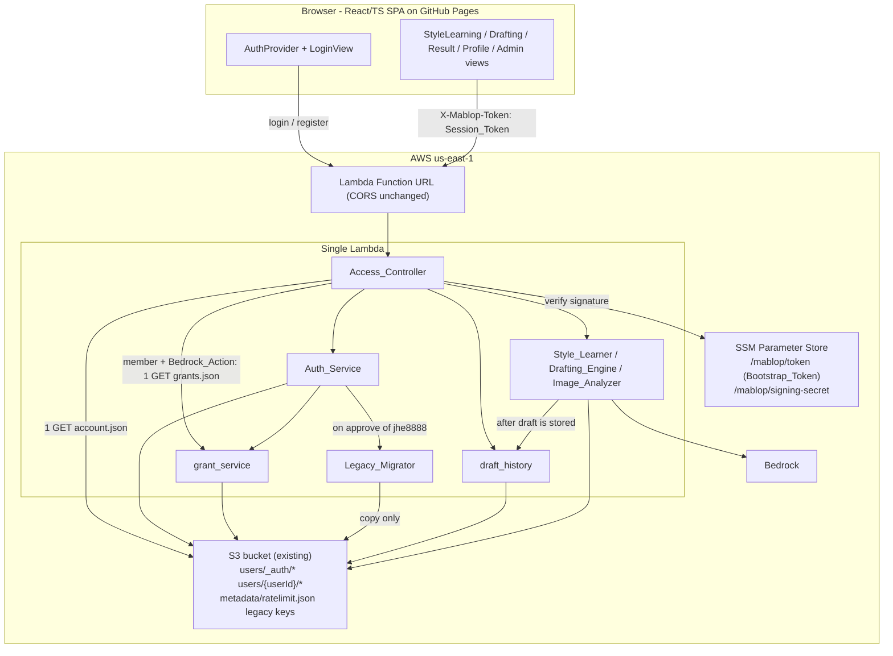
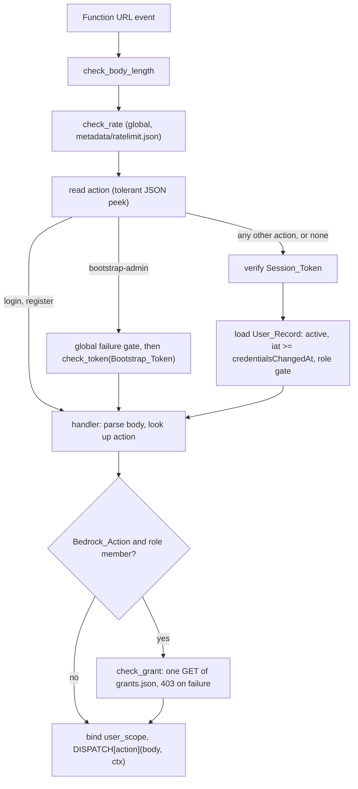

# Design Document

## Overview

This feature replaces the single Pre_Shared_Token with per-user accounts for the 2-3 trusted MABLOP users. It adds registration with administrator approval, password login that returns a stateless HMAC-signed Session_Token, per-user S3 prefixes for all learning data, a one-time Bootstrap that creates the first administrator with an empty workspace, a one-time legacy data binding that copies the existing shared learning data and drafts to the member `jhe8888` when the administrator approves that member, Bedrock usage Grants (request, approval with expiry, per-call verification), a per-user draft history, and three Frontend areas (login, user page, administrator page) plus a Grant selector and a ChatGPT-style history on the Results tab.

The design adds no AWS service, no Python package, and no npm package. Accounts, Grants, and the draft index are JSON objects in the existing bucket. Hashing, signing, and random values use only `hashlib`, `hmac`, `secrets`, `base64`, and `json`. The only new secret is the Signing_Secret in SSM Parameter Store. A Grant carries no secret: its `grantId` is an identifier that is only useful together with a valid Session_Token of the Grant's owner.

### Design Principles

1. **Fail closed.** A request without a verified identity cannot reach any user-scoped S3 key. The key builder raises when no userId is bound. An unknown action without a valid Session_Token returns 401, not 400.
2. **One source of identity.** The acting userId comes only from the verified Session_Token and the User_Record it names. No field in the request body is used for authorization (Req 4.7).
3. **Uniform failures.** Every credential failure of the same kind returns the same status, message, and body shape, and does the same expensive work (Req 2.4, 2.5, 6.1, 6.2).
4. **Non-destructive migration.** The Legacy_Migrator only copies. It has no delete or overwrite code path against Legacy_Keys or Legacy_Drafts, and it never replaces a destination object (Req 9.6, 9.8).
5. **Owner confirmation gates.** IAM edits, SSM parameter creation, deployment, pushing to `main`, and the production `bootstrap-admin` run are prepared as files or documented steps and wait for explicit owner confirmation (Req 18.4-18.11).
6. **Authorization before cost.** A member's request reaches Bedrock only after the Backend has read the member's own Grant_Store and found an approved, unexpired Grant. Nothing is cached, so a revocation applies to the next call (Req 20.5).
7. **Index first, object second.** Every two-step change that spans the Draft_Index and a draft object orders its steps so that a crash leaves a state that a repeat of the same call or the next `list-drafts` repairs (Req 22.4, 22.6, 22.11).

### Design Decisions

These are the points that the requirements delegated to design.

| # | Topic | Decision | Reason and rejected alternative |
|---|---|---|---|
| D1 | Token header | The Session_Token travels in `X-Mablop-Token`, the header that exists today. `bootstrap-admin` carries the Bootstrap_Token in the same header. | The Function URL CORS allows only `Content-Type` and `X-Mablop-Token`. `Authorization` would need an infra CORS change (Req 4.9). |
| D2 | Token format | `base64url(payload_json) + "." + base64url(HMAC-SHA256(secret, base64url(payload_json)))`, no padding. Payload keys: `v` (always 1), `uid`, `iat`, `exp`. `iat` and `exp` are integer epoch milliseconds. | Signing the encoded string avoids JSON canonicalization problems. There is no `alg` field, so there is no algorithm-confusion surface. Milliseconds let `iat >= credentialsChangedAt` be exact (see D4). |
| D3 | Verification order | Shape and length, then signature (constant time), then payload fields and expiry, then the single User_Record read, then status and `credentialsChangedAt`. | Forged or garbled tokens cost one HMAC and no S3 read. Every failure returns the same 401 body. |
| D4 | Credential-change cutoff | `credentialsChangedAt` is ISO-8601 UTC with millisecond precision, converted to integer milliseconds by exact integer arithmetic. Password change and reset use one `now` value for both `credentialsChangedAt` and the new token's `iat`. Disabling a user also sets `credentialsChangedAt`. | A same-second old token cannot pass. Without the disable bump, a re-enabled user's pre-disable token (up to 8 hours old) would work again, which Req 11.10 forbids. |
| D5 | Timing defense | Blocked attempts return before any PBKDF2 work. An unknown or malformed loginId runs one dummy PBKDF2 with the current iteration count. `register` always hashes the submitted password before it looks at whether the loginId exists. All comparisons use `hmac.compare_digest`. | Response time then depends on neither account existence nor registration outcome. The residual difference is one or two S3 GETs (tens of milliseconds) against roughly 0.3-1.5 s of PBKDF2. |
| D6 | userId propagation | The handler binds the verified userId into a `ContextVar` (`user_scope`) for the duration of dispatch. Components obtain keys through `s3store.user_key(relative)`, which reads that variable. Auth_Service and Legacy_Migrator pass explicit userIds. | Existing component signatures and most existing tests stay unchanged. The variable is unset outside dispatch, so a component that runs unbound raises instead of writing to a shared key. Rejected: adding a required `user_id` parameter to about 20 functions, which would change nearly every existing test. |
| D7 | S3 concurrency | Create-once objects (loginId lookup, admin pointer) use `PutObject` with `If-None-Match: *`. Read-modify-write objects (User_Record, throttle state) use one helper, `s3store.update_json`, which reads the ETag and writes with `If-Match`, retrying up to 3 times. | At 2-3 users contention is rare, but a lost update on "disable" would leave a user active. The helper is about 20 lines and replaces ad-hoc locking. Rejected: DynamoDB conditional writes (new service, Req 18.1). |
| D8 | User listing | `ListObjectsV2(Prefix="users/", Delimiter="/")` returns one common prefix per user. The service skips `users/_auth/`, then reads each `account.json`. | One LIST plus N GETs, with N at most about 15 (3 active users plus at most 10 pending). Cost is negligible. A denormalized index file would add a second source of truth. |
| D9 | loginId claim | Registration claims the loginId lookup first (create-once), then writes `account.json`. A lookup whose target account is missing and older than 60 seconds counts as dangling and is overwritten. | A crash between the two writes leaves no visible half-account. The 60-second age rule stops a slow concurrent registration from being healed away. |
| D10 | Delete permission | `admin-reject-user` deletes the User_Record and the lookup entry (Req 11.3), and `delete-draft` deletes a draft object (Req 22.8). This needs `s3:DeleteObject` limited to `users/_auth/login/*`, `users/*/account.json`, and `users/*/generated-posts/*`. | Req 18.5 lists exactly these three. Nothing under the legacy prefixes can be deleted, which keeps Req 9.6 true at the IAM level. See "Deviations and Interpretations" item 1. |
| D11 | Migration overwrite rule | The Legacy_Migrator copies a key only when the destination is absent. A destination of equal size is skipped. A destination of a different size is reported as diverged and is never overwritten (Req 9.7, 9.8). | Re-running `migrate-legacy-data` after the member has learned new posts or generated new drafts must not replace new data with old data. |
| D12 | Keys in responses | Every S3 key returned to the client (`draftKey`, `styleProfileKey`, `indexKey`, `checkpoint`, upload `key`) is the real object key, including the `users/{userId}/` prefix. | One rule, and image keys must be full keys anyway (Req 8.6, 8.7). The Frontend does not display these keys. |
| D13 | No draft copy in the browser | The Frontend no longer stores a draft in `localStorage`. The Results tab reads the Draft_Index (`list-drafts`) and the body (`get-result`). At startup the Frontend deletes every entry whose key starts with `mablop-last-draft` (Req 23.10, 23.11). | The earlier per-browser copy (`mablop-last-draft`, later `mablop-last-draft:{loginId}`) was shared by users of one browser and lost drafts on another device. The server-side history replaces it. |
| D14 | Korean messages | All new backend messages live in one module, `auth_messages.py`, written as UTF-8 literals. Tests compare responses against the literal strings from the requirements, not against the constants. | `style_learner.rebuild_from_stored` already contains a corrupted message (`"??? raw-posts? ????."`). A single module plus literal-string tests catches that class of defect. |
| D15 | Legacy binding trigger | `bootstrap-admin` never runs the Legacy_Migrator. `admin-approve-user` runs it once, right after the status change, when the approved loginId equals `LEGACY_OWNER_LOGIN_ID` (`jhe8888`). `migrate-legacy-data` is an administrator retry action with an optional `targetUserId`. | The legacy data belongs to the member `jhe8888`, so the administrator starts empty (Req 9.4). Rejected: copying to the administrator at bootstrap and moving later, which would need a delete step that Req 9.6 forbids. |
| D16 | Binding record and failure policy | The Legacy_Binding_Record `users/_auth/legacy-owner.json` is created with `If-None-Match: *` before the first copy. The same userId proceeds (idempotent), a different userId yields `already_bound` with no copy. A failed copy keeps the record and the approval. | The record makes "bound once" independent of how many times the copy is retried. Keeping the approval on failure means a copy problem never locks the member out (Req 9.11, 9.19). Residual cost: a failed first run leaves the record naming that user, so a retry for another userId is refused by design. |
| D17 | Grant verification point | A hook in the handler (`access_controller.check_grant`) runs after the body is parsed and the action is known, before dispatch. It applies only to Bedrock_Actions for role `member`. It reads `users/{actingUserId}/metadata/grants.json` once, with no cache. | The check sits in front of every component, so a new Bedrock call site cannot forget it. The acting userId comes from the Session_Token, so another user's `grantId` cannot match (Req 20.3). Rejected: checking inside each component (four call sites and `get-result`, easy to miss one). |
| D18 | Grant expiry is derived | `expired` is computed on read as `status == "approved"` and `expiresAt <= now`. The stored `status` never becomes "expired". | No timer or write is needed when a Grant lapses, and the lapse cannot be missed by a read. The boundary `expiresAt <= now` makes "valid" and "expired" exact complements (Deviations item 8). |
| D19 | Grant store atomicity | Every Grant write (append, status change, pruning to the 20-entry cap) happens inside one `update_json` mutation of `grants.json`, and the precondition checks (one `requested` Grant per user, required status, capacity) run inside that mutation. | Two concurrent requests then cannot both pass a check that the other invalidates. A failed precondition raises inside the mutation, so nothing is written. |
| D20 | Draft index writes | `drafting_engine` stores the draft object first and then updates the Draft_Index with `update_json`. A failed index update is swallowed after the object write succeeded. `list-drafts` adds every object that the index lacks. | The user always gets the generated text (Req 22.4), and the index repairs itself on the next listing (Req 22.6). Rejected: index first, which could leave an entry without an object. |
| D21 | Delete order and existence checks | `delete-draft` removes the index entry first and deletes the object second (Req 22.8). Existence of the object is checked with a `ListObjectsV2` call for the exact key, not `HEAD`. | S3 answers `HEAD` for a missing key with 403 when the role lacks bucket-wide `s3:ListBucket`, so `HEAD` cannot tell "missing" from "denied". A list call with a `users/*` prefix is permitted and is unambiguous. |
| D22 | Grant selection in the browser | The selected `grantId` is kept in `localStorage` under `mablop-grant-id:{loginId}`. No Grant is selected automatically. The buttons that send a Bedrock_Action stay disabled until the member picks one. | The id is not a secret, and keying by loginId keeps two users of one browser apart. Auto-selecting would contradict Req 21.5 (a stale stored id leaves "no selection"). |

## Architecture

### System Context



### Request Pipeline



The order is the one Req 4.2 requires: body length, global rate, read `action`, authenticate. Today the order is body length, token, rate. The rate check moves ahead of authentication so that unauthenticated floods are counted too (Req 5.1). The Grant check comes last, after authentication and before dispatch, so an unauthenticated caller never learns anything about Grants and an unapproved member never reaches a component that could call Bedrock (Req 20.1).

## Components and Interfaces

### Backend module map

| Module | Status | Responsibility |
|---|---|---|
| `user_scope.py` | new | `ContextVar` holding the acting userId. `bind(user_id)` context manager, `current_user_id()` raises `internal_error` when unset. |
| `auth_messages.py` | new | Korean message constants (D14). |
| `auth_log.py` | new | `log(event, outcome, user_id=None)`. Writes one JSON line with exactly those three fields (Req 6.4, 6.5). |
| `auth_crypto.py` | new | PBKDF2 hash and verify, dummy verify, temporary password, Signing_Secret loading, token sign and verify. |
| `auth_store.py` | new | S3 layout for accounts: User_Record I/O, loginId lookup, admin pointer, user listing. |
| `auth_throttle.py` | new | Persisted Login_Throttle state and its pure rules. |
| `auth_service.py` | new | The twelve account actions: `register`, `login`, `bootstrap-admin`, `get-me`, `change-password`, `migrate-legacy-data`, and the six `admin-*-user` actions (list, approve, reject, disable, enable, reset password). |
| `grant_service.py` | new | The six Grant actions (`grant-request`, `grant-list-mine`, `admin-grant-list`, `admin-grant-approve`, `admin-grant-reject`, `admin-grant-revoke`), the Grant_Store transitions, the per-user limits, the derived `expired` flag, and `verify(user_id, grant_id, now)` for the handler hook. |
| `draft_history.py` | new | The Draft_Index (`drafts.json`): `record`, title derivation, back-fill, and the two actions `list-drafts` and `delete-draft`. |
| `legacy_migrator.py` | new | Copy-only migration of Legacy_Keys and Legacy_Drafts with verification, the Legacy_Binding_Record, and the `legacyBinding` summary. |
| `access_controller.py` | changed | Pipeline above, exempt and admin-only action sets, `BEDROCK_ACTIONS`, `check_grant`, `RequestContext`. |
| `handler.py` | changed | New `DISPATCH` entries, `(body, ctx)` call convention, the Grant hook, user binding, generic error mapping for auth-scope actions. |
| `errors.py` | changed | Adds `forbidden` (403) and `not_found` (404) (Req 16.7). |
| `s3store.py` | changed | Key builders and a few helpers. The four existing functions keep their signatures (Req 17.5). |
| `style_learner.py`, `drafting_engine.py`, `image_analyzer.py`, `index_store.py`, `checkpoint.py`, `style_profile.py` | changed | Key construction only (table below). |

`backend/pyproject.toml` lists top-level modules explicitly in `py-modules`. The ten new modules are added there. `backend/requirements.txt` is not touched (Req 17.10).

### errors.py

Two entries are added to `STATUS`: `forbidden: 403` and `not_found: 404`. `MablopError`, `error_body`, `response`, and `error_response` are unchanged. The generic internal-error message for auth-scope actions is applied in `handler.py`, not here, so the existing behavior for Existing_Actions does not change.

### user_scope.py

```python
def bind(user_id: str) -> ContextManager[None]   # validates against USER_ID_PATTERN, resets on exit
def current_user_id() -> str                      # raises MablopError("internal_error") when unbound
```

The module is separate from `s3store.py` on purpose. Existing tests call `importlib.reload(s3store)`, and a reload would otherwise discard the bound user.

### s3store.py additions

```python
USER_ID_PATTERN = r"^u_[0-9a-f]{16}$"
def user_key(relative: str, user_id: str | None = None) -> str   # "users/{id}/{relative}"; id defaults to user_scope
def auth_key(relative: str) -> str                               # "users/_auth/{relative}", same path rules
def assert_own_image_keys(keys: list) -> None                    # Req 8.7
def list_keys(prefix: str) -> list[dict]                         # [{"key", "size", "lastModified"}], paginated; lastModified is UTC ISO-8601 with milliseconds
def key_exists(key: str) -> bool                                 # list_keys(key) contains the exact key (D21)
def read_json_optional(key: str) -> tuple[object, str] | None    # (object, etag), or None when the key is missing
def list_user_ids() -> list[str]                                 # common prefixes of "users/", filtered by USER_ID_PATTERN
def head(key: str) -> dict | None                                # {"size"} or None when absent
def copy(src_key: str, dst_key: str) -> None                     # server-side CopyObject
def delete(key: str) -> None
def put_json_if_absent(key: str, obj) -> bool                    # If-None-Match: *; False when it already exists
def update_json(key: str, mutate, default=None, retries: int = 3) -> dict   # ETag read, If-Match write
```

Key builder rules (Req 8.1, 8.2):

- `user_id` must match `USER_ID_PATTERN`. Otherwise the builder raises `MablopError("internal_error")`, because a userId never comes from user input.
- `relative` must be a non-empty string that does not start with `/` and does not contain `..`. The builder also rejects control characters and backslashes. Violations raise `MablopError("bad_request", "허용되지 않는 경로입니다.")`, because parts of `relative` such as `postId`, `resumeRunId`, and draft `id` do come from the client.
- The pattern `^u_` cannot match `_auth`, so `users/_auth/` never collides with a userId.

`assert_own_image_keys` accepts a key only when it is a string that starts with `users/{acting userId}/images/` and passes the same path rules. Any other key raises `MablopError("bad_request", "허용되지 않는 이미지 경로입니다.")` before any object is read. The check covers all supplied keys, not only the first 10 that are used.

`update_json` loop: read object and ETag (absent object uses `default` and `If-None-Match: *`), call `mutate(obj)` which returns the new object or raises, write with `If-Match`. On a precondition failure it re-reads and retries. After the retries it raises `internal_error`. A `mutate` that raises writes nothing, which is how Grant and Draft_Index precondition failures leave the store unchanged (D19). Because a retry calls `mutate` again on a freshly read object, every `mutate` is a pure function of its argument.

`read_json_optional` treats `NoSuchKey` and 404 as missing. The role has no bucket-wide `s3:ListBucket`, so S3 may answer a read of a missing key with 403 instead (the same effect the Legacy_Migrator relies on for source keys). The helper therefore also maps `AccessDenied` on a read of an object that is optional by design (`grants.json`, `drafts.json`, the loginId lookup, `account.json`) to missing. For authentication this fails closed (an unreadable account is an unknown account), and for the Grant check it means "no Grant", which is a 403. The first deployment on the development bucket must confirm which of the two answers S3 gives.

### auth_crypto.py

```python
PBKDF2_ALG = "pbkdf2_sha256"; PBKDF2_ITERATIONS = 600_000; SALT_BYTES = 16
TOKEN_TTL_MS = 8 * 60 * 60 * 1000; TOKEN_MAX_LEN = 512

def hash_password(password: str, iterations: int = PBKDF2_ITERATIONS) -> dict   # {"alg","iterations","salt","hash"} (hex)
def verify_password(password: str, stored: dict) -> bool                        # uses stored["iterations"]
def burn_verify(password) -> None                                               # one PBKDF2 at PBKDF2_ITERATIONS, result discarded
def generate_temp_password() -> str                                             # 16 chars via secrets.choice
def get_signing_secret() -> str                                                 # SSM, cached per warm container
def sign_token(user_id: str, now_ms: int) -> tuple[str, int]                    # (token, exp_ms)
def verify_token(token, now_ms: int) -> TokenPayload                            # raises unauthorized / internal_error
def to_iso_ms(ms: int) -> str;  def from_iso_ms(s: str) -> int                  # exact integer arithmetic
```

Password rules:

- `hash_password` uses `hashlib.pbkdf2_hmac("sha256", password.encode("utf-8"), salt, iterations)` with `salt = secrets.token_bytes(16)`. `iterations` is a parameter so property tests can use small counts; production callers never pass it (Req 3.1).
- `verify_password` reads `alg` and `iterations` from the stored object. It rejects an unknown `alg` or an iteration count outside 1 to 5,000,000 as `internal_error`. It compares with `hmac.compare_digest` (Req 3.2, 3.3).
- `generate_temp_password` draws 16 characters from `abcdefghjkmnpqrstuvwxyzABCDEFGHJKLMNPQRSTUVWXYZ23456789` (no look-alike characters, about 92 bits). Every such password satisfies the 10-128 policy.

Signing_Secret:

- Path from `MABLOP_SIGNING_SECRET_SSM_PATH`. There is no environment-variable fallback for the value (Req 7.4). Tests create the parameter in moto SSM.
- The loader fails when the path is unset, equals `MABLOP_TOKEN_SSM_PATH`, the read fails, or the value is shorter than 32 characters. Failures raise `MablopError("internal_error", INTERNAL)` and are not cached (Req 7.1, 7.3). A success is cached in a module variable for the warm container (Req 7.2). `reset_cache()` exists for tests.
- Rotating the secret invalidates every token. Warm containers keep the old value until they are recycled, so a rotation needs a redeploy or a wait.

Token verification (D2, D3). Every failure in steps 1-6 raises `MablopError("unauthorized", UNAUTHENTICATED)`:

1. The token is a `str` of 1 to 512 ASCII characters containing exactly one `.` with two non-empty segments.
2. Load the secret. A failure here is `internal_error` (Req 7.3).
3. Decode the signature segment strictly. The decoder rejects characters outside the base64url alphabet and any non-canonical encoding (decoding and re-encoding must reproduce the input). Without the canonical check, changing the unused trailing bits of the last character would produce a different string with the same signature.
4. Compare `HMAC-SHA256(secret, payload_segment)` with the decoded signature using `hmac.compare_digest`.
5. Only now decode the payload segment (same strict decoder) and parse JSON. The keys must be exactly `v`, `uid`, `iat`, `exp`. `v == 1`. `uid` matches `USER_ID_PATTERN`. `iat` and `exp` are integers and not booleans.
6. Require `0 < exp - iat <= TOKEN_TTL_MS`, `iat <= now_ms + 60_000`, and `exp > now_ms`.

The user-record checks (status, `credentialsChangedAt`) happen in the Access_Controller after this function returns.

### auth_store.py

```python
def get_user(user_id: str) -> dict | None                  # one GET of users/{id}/account.json
def find_user_id(login_id: str) -> str | None              # one GET of users/_auth/login/{loginId}.json
def put_user(record: dict) -> None
def update_user(user_id: str, mutate) -> dict              # update_json on account.json
def claim_login_id(login_id, user_id, now_ms) -> str       # "created" | "exists" | "healed"
def release_login_id(login_id, user_id) -> None            # deletes the lookup only when it still names user_id
def delete_user(user_id: str) -> None
def list_users() -> list[dict]                             # D8; skips prefixes without account.json
def admin_pointer() -> str | None;  def commit_admin_pointer(user_id) -> bool
```

`claim_login_id`: try `put_json_if_absent`. If the object exists, read it and then the target account. If the target account exists, return `exists`. If it is missing and the lookup's `createdAt` is more than 60 seconds old, overwrite the lookup and return `healed`. Otherwise return `exists`.

### auth_throttle.py

State is one JSON object (schema under Data Models). The pure rule functions take `(state, now)` and return a new state. The persistence wrapper uses `update_json`.

```python
LOGIN_FAIL_LIMIT = 5; LOGIN_WINDOW_S = 600; LOGIN_BLOCK_S = 600
GLOBAL_FAIL_LIMIT = 30; GLOBAL_WINDOW_S = 600; GLOBAL_BLOCK_S = 600
REGISTER_LIMIT = 5; REGISTER_WINDOW_S = 3600; PENDING_CAP = 10; MAX_ENTRIES = 200

def check_login(login_id: str | None, now) -> None          # read only; raises rate_limited (LOGIN_BLOCKED)
def record_failure(login_id: str | None, now) -> None      # per-loginId entry (only when the format is valid) and global list
def record_success(login_id: str, now) -> None             # removes the entry; writes only when an entry exists
def reset_login(login_id: str) -> None                      # used by admin-reset-password
def guard_global(now) -> None                               # bootstrap-admin gate
def admit_register(now) -> None                             # one atomic check-and-record; raises rate_limited (REGISTER_RATE)
```

Rules:

- A loginId entry holds the failure timestamps inside the last 600 seconds and a `blockedUntil`. The fifth failure inside the window sets `blockedUntil = now + 600`. While `now < blockedUntil`, `check_login` raises even for a correct password (Req 5.2, 5.3). A rejected attempt does not extend the block.
- The global state holds failure timestamps for login, change-password, and bootstrap failures. The 30th failure inside 600 seconds sets `globalBlockedUntil = now + 600`. `check_login` and `guard_global` both honor it (Req 5.6).
- Malformed loginIds count only toward the global list. A per-loginId entry for an attacker-chosen string would let an attacker evict real entries. The global cap of 30 failures per 10 minutes also keeps the number of loginId entries created in any window below `MAX_ENTRIES = 200`, so eviction by flooding cannot happen inside a window.
- `admit_register` keeps the timestamps of the last hour (at most 5). It raises when 5 are already present, so the sixth request is the first rejected (Req 5.7).
- Every write drops expired entries first. If more than 200 loginId entries remain, it evicts the ones with the oldest `last` (Req 5.9).
- The pending cap (Req 5.8) is checked by `auth_service.register` with `list_users()`, after `admit_register` and before any hashing.

### auth_service.py

Every function returns a plain dict and raises only `MablopError`. Signatures are `fn(body, ctx, now=None)`; `now` is epoch seconds and defaults to `time.time()`. Input validation (Req 1.4, 3.4):

- `loginId`: `^[a-z0-9_-]{4,32}$`. Message: "아이디는 영문 소문자, 숫자, 밑줄(_), 하이픈(-)으로 4~32자여야 합니다."
- `name`: after `strip()`, 1 to 30 characters, no control characters. Message: "이름은 1~30자여야 합니다."
- `password`: a string of 10 to 128 characters and no other rule. Message: "비밀번호는 10~128자여야 합니다."

| Action | Steps |
|---|---|
| `register` | 1. Validate fields (`bad_request`). 2. `admit_register` (429). 3. Count `pending` in `list_users()`; 10 or more raises 429 with REGISTER_CLOSED. 4. `hash_password` (always). 5. `claim_login_id`. On `created` or `healed`, `put_user` with role `member`, status `pending`, `approvedAt` null, `credentialsChangedAt` equal to `createdAt`. On `exists`, write nothing. 6. Return `{"message": REGISTER_ACCEPTED}` in both cases (Req 1.1-1.3, 6.2). |
| `login` | 1. Non-string or out-of-format inputs take the failure path. 2. `check_login` (429, before any hashing). 3. `find_user_id`, `get_user`. 4. Missing record: `burn_verify`. Present record: `verify_password`. 5. Failure: `record_failure`, audit log, 401 with LOGIN_FAILED. 6. Password matches: `pending` gives 403 PENDING, `disabled` gives 403 DISABLED, neither touches the throttle. `active`: `record_success`, `sign_token`, return `{"token","expiresAt","user":{"name","loginId","role"}}` (Req 2.1-2.7). |
| `bootstrap-admin` | The Bootstrap_Token was already verified by the Access_Controller (Req 9.1). 1. If the admin pointer exists: 403 ADMIN_EXISTS, nothing else is read (Req 9.3). 2. Validate fields. 3. `hash_password`. 4. Claim the loginId. If it `exists`, resume when it names an account with role `admin` (an interrupted run); otherwise `bad_request` "이미 사용 중인 아이디입니다." 5. `put_user` with role `admin`, status `active`, `approvedAt = createdAt`. 6. `commit_admin_pointer` (create-once). If it loses, delete the new account and lookup and return 403 ADMIN_EXISTS. 7. Return `{"message","user":{"loginId","name","role"}}`. The action never calls the Legacy_Migrator and writes nothing under the new administrator's prefix except `account.json`, so the administrator's `get-learning-status` reports `processedPosts` 0 and `chunks` 0 (Req 9.2, 9.4, D15). |
| `get-me` | Return `userId`, `loginId`, `name`, `role`, `status`, `createdAt` from `ctx.user` (no extra read). |
| `change-password` | 1. `check_login(ctx.user.loginId)` (a blocked loginId also blocks this action, so a stolen session cannot guess the password). 2. Validate `newPassword` policy and `newPassword != currentPassword` (cheap checks first). 3. `verify_password(current)`. On failure: `record_failure`, `bad_request` BAD_CURRENT (never 401, Req 12.5). 4. `hash_password(new)`. 5. `update_user`: store the hash, set `credentialsChangedAt = to_iso_ms(now_ms)`. 6. `sign_token` with the same `now_ms`. Return `{"token","expiresAt"}`. |
| `migrate-legacy-data` | Admin only. Optional `targetUserId`. 1. When it is absent, resolve `find_user_id(LEGACY_OWNER_LOGIN_ID)`. 2. A target that does not match `USER_ID_PATTERN` or has no record gives 404 NOT_FOUND_TARGET. 3. `legacy_migrator.run(target_user_id)`. 4. Status `already_bound` gives 403 with LEGACY_ALREADY_BOUND (Req 9.17); every other status gives 200 with `{"migration": {...}}`, including `failed`. The action adds no role or status restriction on the target, because the Legacy_Binding_Record is the guard. |
| `admin-list-users` | `list_users()` mapped to the seven public fields, pending first, then ascending `createdAt` inside each group. |
| `admin-approve-user` | Target must be `pending`. 1. Inside `update_user`, set `active` and `approvedAt`. 2. When the target's `loginId` equals `LEGACY_OWNER_LOGIN_ID`, call `legacy_migrator.run(target_user_id)` once, wrapped so that any exception becomes a `failed` result. Otherwise the binding is `not_applicable` and no migrator code runs. 3. Return `{"userId","status":"active","legacyBinding":{...}}` where `legacyBinding` is the summary below. The approval is already stored when the migrator starts, so no outcome of the migrator can revert it (Req 9.19). Because only a `pending` target can be approved, the migrator runs at most once per approval and cannot be triggered by a second click. |
| `admin-reject-user` | Target must be `pending`. `release_login_id`, then `delete_user`. The lookup goes first, so a retry after a crash is safe. Returns `{"userId","removed":true}`. |
| `admin-disable-user` | Target must be `active`. Set `disabled` and `credentialsChangedAt` (D4). |
| `admin-enable-user` | Target must be `disabled`. Set `active`. |
| `admin-reset-password` | Any member status. Generate the temporary password, store only its hash, set `credentialsChangedAt`, `reset_login(loginId)`. Return `{"userId","temporaryPassword"}` once. |

Target resolution for the five administrator actions that take a `userId` (approve, reject, disable, enable, reset password): a value that does not match `USER_ID_PATTERN` or has no record gives 404 NOT_FOUND_TARGET. A record with role `admin` gives `bad_request` ADMIN_TARGET. The status precondition is checked last, inside the `update_user` mutation so it sees the freshest record, and a violation raises `bad_request` with a message that names the required status, for example "승인 대기 상태의 계정만 승인할 수 있습니다." The record is unchanged on any failure (Req 11.7-11.9).

Audit log events (Req 6.4, 6.5): `register`, `login`, `bootstrap`, `change-password`, `admin-*`, `token`, `grant`, `legacy-bind`. A `grant` event is written for a denied Grant check, with outcome `blocked`, and for each Grant action. No event carries a `grantId`, a purpose text, or a draft title. Outcome is one of `success`, `failure`, `blocked`, `ignored`, or `error:<ExceptionClassName>`. The `userId` field is present only for an existing User. No other field is written.

### access_controller.py

```python
AUTH_EXEMPT_ACTIONS = frozenset({"login", "register", "bootstrap-admin"})              # Req 4.1
ADMIN_ONLY_ACTIONS = frozenset({"migrate-legacy-data", "admin-list-users", "admin-approve-user",
                                "admin-reject-user", "admin-disable-user", "admin-enable-user",
                                "admin-reset-password", "admin-grant-list", "admin-grant-approve",
                                "admin-grant-reject", "admin-grant-revoke"})           # Req 4.8, 19.16
BEDROCK_ACTIONS = frozenset({"learn-style", "analyze-images", "generate-draft",
                             "rebuild-from-stored", "get-result"})                      # Glossary: Bedrock_Actions
@dataclass(frozen=True)
class RequestContext: action: str | None; user_id: str | None; role: str | None; user: dict | None

def check_request(headers, body, now=None) -> RequestContext
def requires_grant(action: str, body: dict, role: str | None) -> bool      # pure predicate, see below
def check_grant(ctx: RequestContext, body: dict, now=None) -> None          # raises forbidden
```

`check_token`, `check_body_length`, `check_rate`, `_secret`, and `RATELIMIT_KEY` are unchanged (Req 17.1, 17.2). `check_request` changes as follows:

1. `check_body_length`, then `check_rate(now)`.
2. Peek the action: parse the body as JSON with a tolerant parser; `action` is the value only when it is a string. Malformed bodies give `None`. The handler still parses the body itself, so malformed JSON from an authenticated caller keeps today's behavior (500 `internal_error`).
3. `login` or `register`: return a context with no user.
4. `bootstrap-admin`: `auth_throttle.guard_global(now)`, then `check_token(headers)`. A `MablopError` from `check_token` is recorded with `record_failure(None, now)` and re-raised as `unauthorized` with UNAUTHENTICATED. The Bootstrap_Token is accepted nowhere else (Req 10.1).
5. Any other action, including unknown ones and `None`: read `X-Mablop-Token`, `verify_token`, `get_user(uid)`. Require the record to exist, `status == "active"`, and `iat_ms >= from_iso_ms(credentialsChangedAt)`. Any failure is `unauthorized` with UNAUTHENTICATED, with no hint about which check failed (Req 4.3, 4.4, 4.5).
6. If the action is in `ADMIN_ONLY_ACTIONS` and `user.role != "admin"`: `forbidden` with ADMIN_REQUIRED (Req 4.8).
7. Steps 4-6 run inside one guard. An exception other than `MablopError` (for example an S3 outage) becomes `internal_error` with INTERNAL (Req 6.6).

Exactly one `get_user` call happens per authenticated request (Req 18.2). While no admin exists, no User_Record exists, so every action except the three exempt ones fails with 401 (Req 10.5).

#### Grant check (`requires_grant`, `check_grant`)

`check_request` does not read the full body, so the Grant check is a second function that the handler calls after it has parsed the body and found the action in `DISPATCH`.

- `requires_grant(action, body, role)` is true when `role == "member"`, `action` is in `BEDROCK_ACTIONS`, and the action is not `get-result` with `body.get("kind") == "draft"`. A `get-result` without a `kind`, or with any other `kind`, requires a Grant, because that path ends in `style_learner.learn_style` (Req 20.1, 20.8). An `admin` role never requires a Grant (Req 20.6). Actions outside `BEDROCK_ACTIONS` never require one, which covers `issue-presigned-urls`, `get-learning-status`, `preview-learning-sources`, `list-drafts`, `delete-draft`, and the Grant actions (Req 20.9).
- `check_grant(ctx, body, now)` returns immediately when `requires_grant` is false. Otherwise it reads `grantId` from `body` only (Req 20.7) and calls `grant_service.verify(ctx.user_id, grant_id, now)`. A `False` result raises `MablopError("forbidden", GRANT_REQUIRED)`: HTTP 403 with "Bedrock 사용 권한이 필요합니다. 마이페이지에서 신청하세요." The message is identical for every failure cause (Req 20.4).
- `grant_service.verify(user_id, grant_id, now)` returns `False` without any S3 read when `grant_id` is not a string matching `^g_[0-9a-f]{16}$`. Otherwise it makes one `read_json_optional` of `user_key("metadata/grants.json", user_id)`. The result is `True` only if the store holds a Grant with that id whose `status` is `approved` and whose `expiresAt` parses and is later than `now`. A missing store, an unparseable `expiresAt`, or an unreadable store gives `False`. The `user_id` is always the one from the verified Session_Token (Req 20.2, 20.3).
- The function reads the store at most once per request and keeps nothing between requests, so a revocation written by `admin-grant-revoke` is seen by the next call (Req 20.5, 20.10).
- The 403 is written to the audit log with event `grant` and outcome `blocked`; the log line carries the userId and nothing else.

### handler.py

- `DISPATCH` values take `(body, ctx)`. The eight existing entries become `lambda body, ctx: <same call as today>`, so their behavior and the way tests monkeypatch component functions are unchanged. Twenty entries are added: the twelve account actions in `auth_service`, the six Grant actions in `grant_service`, and `list-drafts` and `delete-draft` in `draft_history` (Req 17.4).
- After `check_request`, the handler parses the body as it does today and looks up the function (an unknown action is still `bad_request`). It then calls `access_controller.check_grant(ctx, body)` and runs the function inside `user_scope.bind(ctx.user_id)` when `ctx.user_id` is set. The Grant check therefore happens before any component reads user data or calls Bedrock (Req 20.1).
- Error mapping: `MablopError` maps as today. For any other exception, if the action is in `AUTH_SCOPE_ACTIONS` or the exception came from `check_request`, the response is `internal_error` with INTERNAL and the audit log records `error:<ExceptionClassName>`. `AUTH_SCOPE_ACTIONS` is the set of the twenty new actions (the three public ones, `get-me`, `change-password`, `migrate-legacy-data`, the five administrator account actions, `admin-list-users`, the six Grant actions, `list-drafts`, and `delete-draft`). Including the two draft actions satisfies Req 22.11, which requires the generic message when the object deletion fails. For Existing_Actions the current behavior is kept.

### Changes to existing components

All relative paths stay as module constants. The S3 key is `s3store.user_key(<constant>)`.

| Module | Change |
|---|---|
| `style_learner.py` | `_store_raw`, `_load_raw`, learning-status read and write use `user_key`. `rebuild_from_stored` replaces its direct `boto3` paginator with `s3store.list_keys(user_key("raw-posts/"))` and strips the full prefix to get the postId. `get_learning_status` reads the user's `metadata/learning-status.json` and returns `{"processedPosts": 0, "chunks": 0, "posts": []}` when it is absent (Req 8.8). `indexKey` and `styleProfileKey` in responses are the full keys (D12). |
| `index_store.py` | `build_and_store_index` writes `INDEX_KEY`, `MAP_KEY`, `MANIFEST_KEY` through `user_key`. `load_index` reads the same keys. |
| `style_profile.py` | `store_profile` writes `user_key(_PROFILE_KEY)` and returns it. |
| `checkpoint.py` | `checkpoint_key(run_id)` returns `user_key(f"metadata/learn-checkpoint-{run_id}.json")`. A client-supplied `resumeRunId` containing `..` is rejected by the builder. `clear` deletes the same key. |
| `drafting_engine.py` | `generate_from_prompt` gains an optional `title` argument. It stores at `user_key("generated-posts/{id}.md")`, returns that key as `draftKey`, and then calls `draft_history.record(draft_id, title, markdown)` inside `try/except Exception`: an index failure is logged by exception class only and the draft is returned normally (Req 22.4, D20). `generate_draft` passes the request `title` through. `_load_profile` reads the user's profile. `generate_draft` calls `assert_own_image_keys` first. `get_result` reads only `user_key("generated-posts/{id}.md")`, so another user's draft id behaves like a missing draft. `_retrieve_chunks` converts a missing index into `bad_request` "학습된 글이 없습니다. 먼저 스타일 학습을 진행하세요." instead of an S3 error (see Deviations item 4). |
| `image_analyzer.py` | `issue_presigned_urls` builds `user_key(f"images/{uuid}.{ext}")`. `analyze_images` calls `assert_own_image_keys` first. The caption JSON key is derived from the validated image key, so it also lies under the user's prefix. |

### legacy_migrator.py

```python
LEGACY_OWNER_LOGIN_ID = "jhe8888"                                                       # Req 9.13
LEGACY_SINGLE_KEYS = ("embeddings/index.npy", "embeddings/index-map.json", "vector-index/manifest.json",
                      "style-profile/profile.json", "metadata/learning-status.json")
LEGACY_LISTED_PREFIXES = ("raw-posts/", "generated-posts/")   # only keys ending in ".txt" and ".md" respectively
BINDING_KEY = "users/_auth/legacy-owner.json"                  # Legacy_Binding_Record, Auth_Shared_Prefix
def run(target_user_id: str, now: float | None = None) -> dict   # full result, also written to migration.json
def summarize(result: dict) -> dict                              # the legacyBinding object
NOT_APPLICABLE = {"status": "not_applicable", "copied": 0, "skipped": 0, "failedKeys": [], "divergedKeys": []}
```

`run` is called from exactly two places: `auth_service.admin_approve_user` (when the approved loginId equals `LEGACY_OWNER_LOGIN_ID`) and `auth_service.migrate_legacy_data`. `bootstrap-admin` never calls it (D15). The module imports no delete function. Its only S3 operations are `list_keys`, `head`, `get_json` (status comparison), `copy` (the source is always a Legacy_Key or Legacy_Draft), `put_json_if_absent` (binding record), and `put_json` (`migration.json`). Algorithm:

1. **Bind.** `put_json_if_absent(BINDING_KEY, {"userId": target, "createdAt": now})`. If the record already exists, read it. A record that names the same `target` lets the run proceed (Req 9.16). A record that names a different userId ends the run at once with status `already_bound`, the message "레거시 데이터는 이미 다른 사용자에게 연결되어 있습니다.", no copy, and no write to `migration.json` (Req 9.17). The record is created before any copy and is never rewritten or deleted (D16).
2. **List sources.** `list_keys("raw-posts/")` keeps `*.txt`. `list_keys("generated-posts/")` keeps `*.md`. For each of the five single keys, `head` returns the size; a 404, or a 403 (a missing key reads as 403 because the role has no bucket-wide `s3:ListBucket`), puts the key under `absent`. The legacy `generated-posts/` prefix is listable only after the `s3:prefix` condition is widened (Infrastructure changes).
3. **List destinations.** `list_keys(user_key("raw-posts/", target))`, `list_keys(user_key("generated-posts/", target))`, and one `list_keys` per single key give the destination sizes. Destination state is read with a list call, never with `head`, so an AccessDenied cannot be mistaken for "absent" and trigger an overwrite (D11, D21).
4. **Copy.** For each source key with size `s`, the destination is `user_key(<same relative path>, target)`:
   - absent: `copy`. A failure adds the key to `failedKeys` and the run continues with the next key.
   - present with size `s`: count it as `skipped` (Req 9.7).
   - present with a different size: add the key to `divergedKeys` and leave the destination untouched (Req 9.8).
5. **Verify** (Req 9.9). Every copied object has the source size at the destination. Every source `raw-posts/*.txt` and every source `generated-posts/*.md` has a destination object. A destination `learning-status.json` that was copied or skipped (not diverged) parses to the same JSON as the source. A diverged key counts as present, so it does not fail verification.
6. **Result.** `status` is `failed` when `failedKeys` is not empty or a verification check fails, otherwise `succeeded`. The result holds `status`, `startedAt`, `finishedAt`, `copied`, `skipped`, `absent`, `rawPosts{source,destination}`, `generatedPosts{source,destination}`, `learningStatusEqual`, `failedKeys`, and `divergedKeys`. It is written to `users/{target}/metadata/migration.json` with `put_json`. A failed write of that file is reported as an extra entry in `failedKeys` (`metadata/migration.json`), and the status becomes `failed`.
7. **Summary** (`summarize`, Req 9.18). The `legacyBinding` object is `{"status", "copied", "skipped", "failedKeys", "divergedKeys", "message"}`. `status` is `succeeded`, `failed`, or `already_bound` (`not_applicable` is produced by `auth_service` without calling the migrator). `message` is Korean: "기존 학습 데이터와 초안을 연결했습니다." for `succeeded`; for `failed`, "기존 데이터 연결에 실패했습니다. 승인은 유지되었습니다. 관리자 권한으로 데이터 연결을 다시 실행하세요." (the failed keys travel in the `failedKeys` array, not in the text); for `already_bound`, the already-bound message of step 1. An unexpected exception inside `run` is caught by `auth_service` and becomes `failed` with an empty `failedKeys` and the same `failed` message (Req 9.19). The exception text is not returned.

Learn checkpoints, `images/*`, and `metadata/ratelimit.json` are not in any list and are never read or copied (Req 9.5). After a successful run for the Legacy_Owner, `get-learning-status` reads the copied `metadata/learning-status.json` and reports 9 processed posts and 31 chunks, and `list-drafts` back-fills the copied `generated-posts/*.md` (Req 9.10, 22.14). The Legacy_Migrator does not write the Draft_Index (D20). `CopyObject` stamps each destination with the copy time, so the back-filled `createdAt` of a legacy draft is the copy time, not the original creation time (Deviations item 2). The originals are removed only by a separate manual owner step (Req 9.20).

### grant_service.py

```python
GRANT_ID_PATTERN = r"^g_[0-9a-f]{16}$"
EXPIRY_CHOICES = (7, 30, 90); DEFAULT_EXPIRY_DAYS = 30; MAX_GRANTS = 20; PURPOSE_MAX = 100

def request(body, ctx, now=None) -> dict               # grant-request
def list_mine(body, ctx, now=None) -> dict             # grant-list-mine
def admin_list(body, ctx, now=None) -> dict            # admin-grant-list
def admin_approve(body, ctx, now=None) -> dict         # admin-grant-approve
def admin_reject(body, ctx, now=None) -> dict          # admin-grant-reject
def admin_revoke(body, ctx, now=None) -> dict          # admin-grant-revoke
def verify(user_id, grant_id, now_ms) -> bool          # used by access_controller.check_grant
def is_expired(grant: dict, now_ms: int) -> bool       # pure, D18
```

All functions work on one object per user, `users/{userId}/metadata/grants.json` (Data Models), through `update_json` with the default `{"v": 1, "grants": []}` (Req 19.1). The user id is always explicit (`user_key(rel, user_id)`), not read from `user_scope`, because the administrator actions operate on other users. Times are stored as UTC ISO-8601 with milliseconds and compared as integer milliseconds through `from_iso_ms`.

| Action | Steps |
|---|---|
| `grant-request` | 1. `purpose` is absent, `null`, or a string of at most 100 characters; anything else gives `bad_request` "사용 목적은 100자 이하로 입력하세요." (Req 19.4). An empty or blank string is stored as `null`. 2. `update_json` on the acting user's store with a mutation that, in this order, (a) raises `bad_request` "이미 승인 대기 중인 신청이 있습니다." when a Grant has `status == "requested"` (Req 19.5), (b) when the store holds 20 Grants, removes the Grant with the oldest `requestedAt` among those that are `rejected`, `revoked`, or expired, and raises `bad_request` "더 이상 신청할 수 없습니다. 관리자에게 문의하세요." when none is removable (Req 19.17, 19.18), (c) appends `{id, status: "requested", purpose, requestedAt: now, decidedAt: null, expiresAt: null}` with `id = "g_" + secrets.token_hex(8)`, regenerated if it collides with an existing id (Req 19.3). 3. Return `{"grant": {...}}` with the public fields and `expired: false`. |
| `grant-list-mine` | One read of the acting user's store. Return `{"grants": [...]}` with `id`, `status`, `purpose`, `requestedAt`, `decidedAt`, `expiresAt`, and `expired`, ordered by `requestedAt` descending, ties broken by `id` descending (Req 19.6). A missing store gives an empty list. |
| `admin-grant-list` | `auth_store.list_users()` supplies `userId`, `loginId`, and `name`; one `read_json_optional` of each user's store follows (at most about 15 reads, D8). Return `{"grants": [...]}` with the fields of `grant-list-mine` plus `userId`, `loginId`, and `name`. Grants with `status == "requested"` come first, the rest follow, and each group is ordered by `requestedAt` descending, ties by `id` descending (Req 19.7). |
| `admin-grant-approve` | 1. Resolve the target as the administrator account actions do: a malformed `userId` or one without a record gives 404 "대상 사용자를 찾을 수 없습니다." (Req 19.15). 2. `expiresInDays` is absent (30) or one of 7, 30, 90; any other value, including a boolean, a float, or a string, gives `bad_request` "만료 기간은 7일, 30일, 90일 중에서 선택하세요." with no read of the store (Req 19.9, 19.10). 3. `update_json` on the target's store; the mutation finds the Grant by `grantId` (404 "대상 권한을 찾을 수 없습니다." when absent, Req 19.14), requires `status == "requested"` (otherwise `bad_request` "승인 대기 상태의 권한만 승인할 수 있습니다.", Req 19.13), and sets `status = "approved"`, `decidedAt = now`, `expiresAt = decidedAt + expiresInDays days` (Req 19.8). 4. Return `{"userId", "grant": {...}}`. |
| `admin-grant-reject` | Same target and Grant lookup. Requires `requested` ("승인 대기 상태의 권한만 거절할 수 있습니다."). Sets `status = "rejected"` and `decidedAt = now`; `expiresAt` stays `null` (Req 19.11). |
| `admin-grant-revoke` | Same target and Grant lookup. Requires `approved` ("승인된 권한만 폐기할 수 있습니다."). Sets `status = "revoked"` and `decidedAt = now`; `expiresAt` is kept so the history still shows when the Grant would have ended (Req 19.12). An approved Grant that has already expired can still be revoked, which is harmless. |

The status check and the field changes run inside the `update_json` mutation (D19), so a failed precondition leaves the stored object byte-identical. The administrator actions do not restrict which user owns the Grant: an administrator's own store works the same way, although the administrator is exempt from verification and the Frontend offers no request form to the administrator (Req 14.9).

### draft_history.py

```python
INDEX_REL = "metadata/drafts.json"; DRAFT_PREFIX = "generated-posts/"
LIST_CAP = 100; UNTITLED = "제목 없음"

def derive_title(requested, markdown: str) -> str       # pure, Req 22.2
def valid_draft_id(draft_id) -> bool                    # pure, Req 22.9
def record(draft_id: str, requested_title, markdown: str, now=None) -> None   # Req 22.1
def list_drafts(body, ctx, now=None) -> dict            # list-drafts
def delete_draft(body, ctx, now=None) -> dict           # delete-draft
```

Both actions run inside `user_scope.bind`, so they use `user_key(...)` and never see another user's prefix (Req 22.13).

`derive_title(requested, markdown)`:

1. If `requested` is a string whose `strip()` is not empty, the title is `requested.strip()`.
2. Otherwise the first line of `markdown` that starts with `#` (no leading whitespace is skipped) gives the title `line.lstrip("# ").strip()`.
3. If that text is empty, or no line starts with `#`, the title is "제목 없음".

`valid_draft_id(x)` is true only for a non-empty string that contains no `/`, no `\`, no `..`, and no control character. Draft ids that the engine generates (`draft-` plus 32 hex characters) always pass. A legacy draft id is the file name without `.md`, which also passes, because the migrator only copies top-level `generated-posts/*.md` keys.

`record`: one `update_json` of `user_key(INDEX_REL)` with default `{"v": 1, "drafts": []}`. The mutation removes any existing entry with the same `draftId` and appends `{draftId, title, createdAt}`, where `createdAt` is the UTC ISO-8601 time with milliseconds (Req 22.3). The entries are not capped in the store; only `list-drafts` caps its output.

`list_drafts`:

1. One `read_json_optional` of the index (Req 22.5).
2. `list_keys(user_key("generated-posts/"))` keeps keys of the form `generated-posts/{id}.md` where `id` passes `valid_draft_id`. The listing carries `lastModified` for each object.
3. For every listed object whose `draftId` is not in the index, `get_bytes` reads the body to derive the title with `derive_title(None, body)`, and the entry takes `createdAt = lastModified` of the object (Req 22.6). A body that cannot be read leaves that object out of this call; the next call tries again.
4. If any entry was gathered in step 3, one `update_json` adds the entries whose `draftId` is still absent (the mutation re-checks, so a concurrent `record` or back-fill never creates a duplicate). Each object is therefore back-filled once.
5. Return `{"drafts": [{draftId, title, createdAt}, ...]}` sorted by `createdAt` descending, ties broken by `draftId` descending, cut at 100 (Req 22.7).

`delete_draft`:

1. `draftId` must pass `valid_draft_id`; otherwise `bad_request` "올바르지 않은 초안 번호입니다." and nothing is read or deleted (Req 22.9).
2. Read the index (`read_json_optional`) and call `s3store.key_exists(user_key("generated-posts/{id}.md"))`. When the index has no such entry and the object does not exist, raise `not_found` "대상 초안을 찾을 수 없습니다." (Req 22.10).
3. `update_json` removes the entry from the index. The mutation is a no-op on an absent entry, so a repeated call after a crash is safe (Req 22.8).
4. `s3store.delete(user_key("generated-posts/{id}.md"))`. A failure here propagates as an exception, and the handler maps it to `internal_error` with the generic message because `delete-draft` is in `AUTH_SCOPE_ACTIONS` (Req 22.11). The index entry is already gone, so a repeated `delete-draft` finds the object without an entry, passes step 2, and deletes the object.
5. Return `{"draftId": id, "deleted": true}`.

An interrupted delete (index updated, object kept) leaves an object that `list-drafts` back-fills again. The draft reappears in the list, and the user can delete it again. This is the price of the order that Req 22.8 and 22.11 fix (Deviations item 9).

### Infrastructure changes (prepared, not applied)

These are file edits to `infra/template.yaml` and the mirror `infra/lambda-role-policy.json`. Nothing is applied until the owner confirms (Req 18.4, 18.5). Pushing to `main` runs `sam deploy`, which applies the role policy, so the push also needs confirmation (Req 18.7).

| Area | Change |
|---|---|
| Parameter | `MablopSigningSecretSsmPath`, type String, default `/mablop/signing-secret`. Only the path is in the template. |
| Function environment | `MABLOP_SIGNING_SECRET_SSM_PATH: !Ref MablopSigningSecretSsmPath`. `MABLOP_TOKEN_SSM_PATH` stays because `bootstrap-admin` still reads the Bootstrap_Token. |
| `S3Prefixes` | Add `arn:aws:s3:::${Bucket}/users/*`. The eight legacy prefixes stay until the owner confirms the migration (Req 18.8). Actions stay `s3:GetObject` and `s3:PutObject`. `CopyObject` needs Get on the source and Put on the destination, both covered. |
| List permission | The existing `ListRawPosts` statement allows `s3:ListBucket` on the bucket with the `s3:prefix` condition `raw-posts/*` only (checked in `infra/template.yaml`). It gains two values: `users/*` (user listing with `Delimiter`, `list_keys` over a user's `raw-posts/` and `generated-posts/`, and the exact-key existence check of D21) and `generated-posts/*` (the legacy draft listing of the Legacy_Migrator). `users/*` also matches the prefix `users/` itself, because `*` matches the empty string. The statement keeps its `Sid` `ListRawPosts` so that the existing infra test and references stay valid, although the name is now narrower than the statement (Req 18.10). |
| Delete permission | New statement `s3:DeleteObject` on `users/_auth/login/*`, `users/*/account.json`, and `users/*/generated-posts/*` only (D10, Req 18.5, 18.11). No delete permission exists on any legacy prefix. |
| SSM | The `ReadToken` statement lists both parameter ARNs (`/mablop/token` and the signing-secret path). SecureStrings use the AWS-managed `aws/ssm` key, so no `kms:Decrypt` grant is needed, as with the existing token. |
| Unchanged | Function URL CORS (`Content-Type`, `X-Mablop-Token`), the bucket CORS, the billing alarm, the resource types, and the GitHub deploy role (it already has `iam:PutRolePolicy` on `role/mablop-*` and `ssm:GetParameter` on `/mablop/*`). |

The Signing_Secret parameter is created by the owner (a SecureString of at least 32 random characters), not by CloudFormation, so the value never appears in a template (Req 7.4, 18.6).

### Frontend structure

```
src/auth/session.ts        storage helpers for mablop-session and the legacy-key purge (mablop-token, mablop-last-draft*)
src/auth/AuthContext.tsx   AuthProvider and useAuth()
src/grants/useGrants.ts    new: loads grant-list-mine, filters usable Grants, keeps the selection in mablop-grant-id:{loginId}
src/grants/GrantSelect.tsx new: the "Bedrock 사용 권한" dropdown and its empty-state text
src/format.ts              formatKst (moved from StyleLearningView, shared by views) and formatKstDate (YYYY-MM-DD)
src/api.ts                 changed
src/views/LoginView.tsx    new
src/views/ProfileView.tsx  new: account, learning summary, password, Bedrock 사용 권한 (members)
src/views/AdminView.tsx    new: 가입 신청, 전체 사용자, 권한 관리, legacy binding notice
src/views/ResultView.tsx   rewritten: draft history (list on the left, body on the right)
src/views/StyleLearningView.tsx, DraftingView.tsx   changed: GrantSelect, grantId in Bedrock_Actions
src/App.tsx                changed: provider, gate, role-based tabs, latest draft hand-off
src/TokenField.tsx         deleted
```

No library is added. `lucide-react` icons used: `User`, `ShieldCheck`, `LogOut`, `KeyRound`, `Copy`, `Check`, `CircleAlert`, `Info`, `Download`, `Trash2` (confirm the names against the installed version when implementing).

#### session.ts and AuthContext

- Stored value under `mablop-session`: `{"token", "expiresAt", "user": {"loginId", "name", "role"}}`. `readSession(now)` returns `null` and removes the entry when the JSON is invalid, the shape is wrong, or `Date.parse(expiresAt) <= now` (Req 13.6).
- `purgeLegacyStorage()` removes the old shared-token entry and every entry whose key starts with the draft-copy prefix. Both key strings are constants in `session.ts` and are only ever used for removal (`removeItem`, and a loop over `localStorage` keys with `startsWith`). Req 10.2 and Req 23.10 are read as "no component reads or writes them" (Deviations item 5). `AuthProvider` calls it once at startup (Req 10.3, 23.11).
- `useAuth()` returns `{ user, notice, login, register, logout, replaceToken }`. Without a provider it returns `user: null` and no-op functions, so view tests that render one view alone keep working.
- `login` calls `postJson({action: "login", loginId, password})`, stores the session, and clears the notice. `register` returns the backend message and does not log in (Req 13.4). `logout` removes the session and does not call the backend, because server-side revocation is out of scope. `replaceToken(token, expiresAt)` rewrites only those two fields (Req 14.6).

#### api.ts

- `postJson<T>(body)` no longer takes a token argument. It reads the token from `readSession` and sends it in `X-Mablop-Token` for every action except `login`, `register`, and `bootstrap-admin` (`PUBLIC_ACTIONS`, mirrors Auth_Exempt_Actions) (Req 13.9). Tests that spy on `postJson` with `(body)` keep working.
- `setUnauthorizedHandler(fn)` lets `AuthProvider` register a callback. When a non-public request returns 401, `postJson` calls it before throwing `ApiRequestError`. The callback removes the session and sets the notice "로그인이 만료되었습니다. 다시 로그인하세요." (Req 13.7). A 401 from `login` is a wrong password and does not call it. A wrong current password is a 400, so `change-password` never triggers it (Req 12.5).
- A `fetch` rejection becomes `ApiRequestError(0, "network", "서버에 연결할 수 없습니다. 잠시 후 다시 시도하세요.")`. An error body that is not JSON gets a Korean fallback message (Req 13.12).

#### Screens

**LoginView.** A single centered column with generous whitespace and no navigation. The wordmark and subtitle sit on top. Two modes are `role="tab"` elements named "로그인" and "가입 신청" inside a `role="tablist"`. The submit button is a real `button` named "로그인" or "가입 신청", so `getByRole("button")` and `getByRole("tab")` do not collide.

| Mode | Fields (each with a visible `<label>`) | `autocomplete` |
|---|---|---|
| 로그인 | 아이디, 비밀번호 | `username`, `current-password` |
| 가입 신청 | 이름, 아이디, 비밀번호, 비밀번호 확인 | `name`, `username`, `new-password`, `new-password` |

Behavior: the `loginId` is trimmed and lower-cased before sending. Different passwords in registration mode show "비밀번호가 일치하지 않습니다." and send nothing (Req 13.3). The submit button is disabled and reads "처리 중..." while a request runs (Req 13.10). A successful registration shows the backend message in a `role="status"` callout and switches to login mode. Errors use `role="alert"`. The expiry notice from `AuthContext` shows above the form. Hints under the fields state the loginId and password rules.

**ProfileView ("내 정보").** Loads `get-me` and `get-learning-status` in parallel. Sections:

1. Account: "이름" and "아이디" as read-only text in a definition list.
2. Learning summary: "학습한 글 N개", "청크 N개", "최근 학습" in KST through `formatKst`. When `processedPosts` is 0 the section shows only "아직 학습한 글이 없습니다." (Req 14.4).
3. Password change form: "현재 비밀번호" (`current-password`), "새 비밀번호" and "새 비밀번호 확인" (`new-password`). A mismatch shows "비밀번호가 일치하지 않습니다." without a request. Success calls `replaceToken`, clears the form, and shows "비밀번호가 변경되었습니다." in a `role="status"` element.
4. "Bedrock 사용 권한" (rendered only when `user.role === "member"`, Req 14.9). It loads `grant-list-mine` on mount and holds `grants`, `purpose`, `submitting`, and `error` in component state.
   - Request form: an optional "사용 목적" text input with `maxLength={100}` and a "사용 권한 신청" button. Submit sends `grant-request` with `purpose`, clears the form on success, and reloads the list (Req 14.10).
   - History: Grants in the order returned (newest first). Each row shows a status badge, the request time through `formatKst`, and for an `approved` Grant the expiry date through `formatKstDate`. The badge text is "대기" (`requested`), "승인" (`approved`), "거절" (`rejected`), "폐기" (`revoked`), or "만료" (`approved` with `expired: true`) (Req 14.11). Badge classes reuse `.badge-active` (승인), `.badge-pending` (대기), and `.badge-disabled` (거절, 폐기, 만료).
   - When any Grant has `status === "requested"`, the input and button are disabled and the text "승인 대기 중인 신청이 있습니다." appears (Req 14.12). An empty history shows "아직 신청한 사용 권한이 없습니다." (Req 14.13).
   - A failed `grant-request` or `grant-list-mine` shows the Backend's Korean message in a `role="alert"` element inside the section (Req 14.14). A failure of this section does not hide the rest of the page.
5. "로그아웃" button.

There is no draft list, no account deletion, and no usage statistics (Req 14.8). The draft history lives only on the Results tab.

**AdminView ("관리").** Loads `admin-list-users` and `admin-grant-list` on mount. It reloads the user list after every successful account action (Req 15.8) and the Grant lists after every successful Grant action (Req 15.16). The two loads are independent, so a failure of one does not blank the other. Sections:

1. "가입 신청": pending users with 이름, 아이디, 신청 시각, and the buttons "승인" and "거절". An empty list shows "대기 중인 가입 신청이 없습니다." (Req 15.9).
2. "전체 사용자": 이름, 아이디, 상태 (대기, 활성, 비활성), 가입일. For members only, an active user shows "비활성화", a disabled user shows "재활성화", and every member shows "비밀번호 초기화" (Req 15.5). Admin rows show no controls.
3. "권한 관리" (a section on the same page, Req 15.12), with two lists:
   - "신청 대기": Grants with `status === "requested"`, each row showing 이름, 아이디, 사용 목적 (a dash when `null`), 신청 시각, a "승인" button, a select labeled "만료 기간" with the choices 7일, 30일, and 90일 (default 30일), and a "거절" button (Req 15.13). "승인" sends `admin-grant-approve` with the row's `expiresInDays` immediately. An empty list shows "대기 중인 사용 권한 신청이 없습니다." (Req 15.17).
   - "발급 내역": every other Grant, showing 이름, 아이디, a status badge ("승인", "거절", "폐기", or "만료" for `expired: true`), and the expiry date. A "폐기" button appears only for `approved` Grants with `expired: false` (Req 15.14).
   - "거절" and "폐기" use the in-page confirmation of the account actions ("확인" and "취소") before the request is sent (Req 15.15).

State: one `confirming: {userId, action} | null` for account actions and a second, `confirmingGrant: {userId, grantId, action} | null`, for Grant actions; the two never overlap in the UI because opening one clears the other. Selecting "거절", "비활성화", or "비밀번호 초기화" replaces that row's buttons with "확인" and "취소" in place (Req 15.6). "승인" and "재활성화" send immediately. `busy` is a set of userIds so a row cannot be double-submitted. `rowErrors: Record<userId, string>` shows the backend's Korean message under the affected row with `role="alert"` (Req 15.10).

A temporary password is held only in component state: a boxed monospace value, a "복사" button using `navigator.clipboard.writeText`, the text "이 비밀번호는 다시 표시되지 않습니다.", and a "닫기" button. Dismissing it, or leaving the tab (the view unmounts), discards it. It is never written to storage (Req 15.7).

Grant rows follow the same pattern with a composite key `"{userId}:{grantId}"`: a `busy` set prevents double submission, `grantErrors: Record<key, string>` shows the Backend's Korean message in a `role="alert"` element next to the affected Grant (Req 15.18), and `expiryDays: Record<key, 7 | 30 | 90>` holds each pending row's selection with 30 as the default.

Legacy binding notice: when `admin-approve-user` returns `legacyBinding.status` of `failed` or `already_bound`, the view stores `legacyNotices[userId] = legacyBinding.message` and renders it in a `role="alert"` element under that user's row. The user stays listed as active, because the reload after the approval returns `active` (Req 15.11). The notice lives in component state only, so it disappears when the administrator leaves the page. For `succeeded` and `not_applicable` nothing extra is shown. The page has no retry button for the binding; the administrator runs `migrate-legacy-data` through the API (Deviations item 10).

`App` shows the "관리" tab only when `user.role === "admin"`, and `AdminView` is not rendered otherwise (Req 15.2). Authorization is enforced by the backend regardless.

#### App and tabs

`App` renders `AuthProvider`, which renders `LoginView` when there is no valid session and the main shell otherwise. Tabs: 스타일 학습, 초안 작성, 결과, 내 정보, and for admins 관리. The tab strip becomes horizontally scrollable on narrow screens (`overflow-x: auto`, `flex: 0 0 auto` under 640 px) so five tabs do not truncate their labels.

`App` also holds `latestDraftId: string | null`. `DraftingView` receives `onDraftCreated(draftId)` and calls it with the `draftId` of each `generate-draft` response. `ResultView` receives `focusDraftId={latestDraftId}` and `onFocusHandled` (which sets the state back to `null`), so the next visit to the Results tab selects the new draft once and later visits start without a selection (Req 23.5).

#### Grant selection (`useGrants`, `GrantSelect`)

- `useGrants()` reads `user` from `useAuth()`. For role `admin`, and for `user: null` (a view rendered without a provider in a test), it returns `{enabled: false}` and sends no request (Req 21.9). For role `member` it calls `grant-list-mine` on mount and exposes `options`, `selectedId`, `select(id)`, `reload()`, `loading`, and `error`.
- `options` are the Grants with `status === "approved"` and `expired === false`, ordered as returned (Req 21.2). The `<select>` shows a first option "선택하세요" with an empty value, then one `<option>` per Grant labeled "Bedrock 사용 권한 · {formatKstDate(decidedAt)} · {formatKstDate(expiresAt)}" (Req 21.3). `formatKstDate` converts to KST (UTC+9) and prints `YYYY-MM-DD`.
- `select(id)` writes `mablop-grant-id:{loginId}` to `localStorage` (Req 21.4). After every load, a stored id that is not in `options` is removed and the selection is empty (Req 21.5). Nothing is selected automatically (D22).
- `GrantSelect` renders a `<label>` "Bedrock 사용 권한" tied to the `<select>` (Req 21.10). When `options` is empty it also renders "사용 가능한 Bedrock 사용 권한이 없습니다. 마이페이지에서 신청하세요." in a `role="status"` element (Req 21.7). The component renders nothing for an admin.
- The hook exposes `canCallBedrock = !enabled || selectedId !== null`. The buttons that send a Bedrock_Action are disabled while `canCallBedrock` is false (Req 21.7).
- `withGrant(body)` returns `{...body, grantId: selectedId}` for a member and `body` unchanged for an admin (Req 21.6, 21.9). `handleGrantError(err)` returns true and calls `reload()` when `err` is an `ApiRequestError` with status 403 and code `forbidden`; the calling view shows `err.message` (Req 21.8).

#### Existing views

- `StyleLearningView` and `DraftingView` drop `TokenField`, the token state, and the `localStorage` token code. Calls become `postJson(body)`. The guard `if (!token) return` in `loadLearningStatus` is removed. The preview message "토큰과 네이버 블로그 URL을 먼저 입력하세요." becomes "네이버 블로그 URL을 먼저 입력하세요."
- Both views render `GrantSelect` above their form. Every Bedrock_Action they send goes through `withGrant`: `learn-style` and `rebuild-from-stored` in the style view, and `analyze-images` and `generate-draft` in the drafting view. `issue-presigned-urls`, `get-learning-status`, and `preview-learning-sources` carry no `grantId`. A 403 `forbidden` response shows the Backend message in the view's existing error callout and reloads the options through `handleGrantError`.
- `DraftingView` no longer writes a draft to `localStorage`. It keeps its inline preview, copy, and download controls for the draft in memory and calls `onDraftCreated`.

#### ResultView (draft history)

`ResultView` is rewritten as a two-pane history in the style of a chat application. Its old `loading`, `markdown`, and `error` props are replaced by `focusDraftId` and `onFocusHandled`. It reads nothing from `localStorage`.

- Layout: a `.history-layout` grid with the Draft_History_List on the left (`minmax(220px, 280px)`) and the body pane on the right (`1fr`). At `max-width: 640px`, the same breakpoint the stylesheet already uses, it becomes one column with the list above the body (Req 23.9).
- State: `drafts`, `listError`, `selectedId`, `body`, `bodyLoading`, `bodyError`, `confirmingId`, `deleteError: Record<draftId, string>`, and `copied`.
- Open (Req 23.1): `list-drafts` on mount. If `focusDraftId` is in the result, select it and call `onFocusHandled`; if the id is not yet listed, `onFocusHandled` is still called once and nothing is selected.
- List entry: a select button with the title and the creation time through `formatKst`, plus a delete button (`Trash2` icon, `aria-label` "삭제") (Req 23.2). The selected entry has `aria-current="true"`. An empty list shows "아직 만든 초안이 없습니다." (Req 23.3).
- Select: `get-result` with `{kind: "draft", id}`; the body appears in the right pane inside the existing `.draft-output` `<pre>`, with a "복사" button (`navigator.clipboard.writeText`) and a "다운로드" button that saves a Blob as `{draftId}.md` with type `text/markdown` (Req 23.4). A response that arrives after the user selected another entry is discarded (the handler compares the id with `selectedId`).
- Delete: the entry's buttons are replaced in place by "확인" and "취소" (Req 23.6). "확인" sends `delete-draft`. On success the list reloads and, when the deleted draft was selected, `selectedId` and `body` are cleared (Req 23.7).
- Errors: `list-drafts` failures show in a `role="alert"` callout above the list, `get-result` failures in the body pane, and `delete-draft` failures under the affected entry, all with the Backend's Korean message (Req 23.8).
- `get-result` and `delete-draft` need no Grant, so `ResultView` has no `GrantSelect` and sends no `grantId` (Req 20.8, 20.9).

#### Styling

New rules extend `index.css` with the existing variables only: `.auth-shell` (grid, centered, `min-height: 100dvh`, column width 360 px), `.mode-tabs`, `.badge` with `.badge-active` (accent-soft), `.badge-pending` (neutral line), `.badge-disabled` (danger-soft), `.user-row`, `.confirm-inline`, `.secret-box`, and `.info-list`. The Grant and history screens add `.grant-row`, `.history-layout` (two-column grid, one column inside the existing `@media (max-width: 640px)` block), `.history-list`, `.history-item` with a `.active` variant (accent-soft background, no gradient), and `.history-body`. No gradients, no emoji, Pretendard, one green accent. The `.token-saved` rule is removed. Every button keeps the 44 px minimum height on coarse pointers through the existing media query.

## Data Models

### S3 layout

```
users/_auth/login/{loginId}.json        loginId lookup (Auth_Shared_Prefix)
users/_auth/throttle.json               Login_Throttle state
users/_auth/admin.json                  admin pointer, written last during bootstrap
users/{userId}/account.json             User_Record
users/{userId}/raw-posts/{postId}.txt
users/{userId}/embeddings/index.npy
users/{userId}/embeddings/index-map.json
users/{userId}/vector-index/manifest.json
users/{userId}/style-profile/profile.json
users/{userId}/metadata/learning-status.json
users/{userId}/metadata/learn-checkpoint-{runId}.json
users/{userId}/metadata/migration.json  written by the Legacy_Migrator for the bound user only
users/{userId}/metadata/grants.json     Grant_Store
users/{userId}/metadata/drafts.json     Draft_Index
users/{userId}/images/{imgId}.{ext} and {imgId}.json
users/{userId}/generated-posts/{draftId}.md
users/_auth/legacy-owner.json           Legacy_Binding_Record (create-once)
metadata/ratelimit.json                 global request window, unchanged (Req 8.9)
raw-posts/*  embeddings/*  vector-index/*  style-profile/*  metadata/learning-status.json  generated-posts/*.md   legacy, read only by Legacy_Migrator
```

### User_Record (`users/{userId}/account.json`)

```json
{
  "v": 1,
  "userId": "u_0123456789abcdef",
  "loginId": "jinjin",
  "name": "진진",
  "role": "member",
  "status": "pending",
  "password": { "alg": "pbkdf2_sha256", "iterations": 600000, "salt": "<32 hex>", "hash": "<64 hex>" },
  "createdAt": "2025-01-02T03:04:05.678Z",
  "approvedAt": null,
  "credentialsChangedAt": "2025-01-02T03:04:05.678Z"
}
```

`role` is `member` or `admin`. `status` is `pending`, `active`, or `disabled`. All timestamps are UTC ISO-8601 with milliseconds. Responses never include the `password` object (Req 6.3).

### Login lookup (`users/_auth/login/{loginId}.json`)

```json
{ "userId": "u_0123456789abcdef", "createdAt": "2025-01-02T03:04:05.678Z" }
```

### Login_Throttle (`users/_auth/throttle.json`)

```json
{
  "v": 1,
  "login": { "jinjin": { "fails": [1735787045, 1735787050], "blockedUntil": 0, "last": 1735787050 } },
  "globalFails": [1735787045],
  "globalBlockedUntil": 0,
  "registers": [1735780000]
}
```

All times are epoch seconds. `login` holds at most 200 entries. `globalFails` holds at most 31 timestamps (the list stops growing once blocked). `registers` holds at most 5.

### Admin pointer (`users/_auth/admin.json`)

```json
{ "userId": "u_0123456789abcdef", "createdAt": "2025-01-02T03:04:05.678Z" }
```

### Session_Token payload

```json
{ "v": 1, "uid": "u_0123456789abcdef", "iat": 1735787045000, "exp": 1735815845000 }
```

### migration.json (`users/{userId}/metadata/migration.json`)

```json
{
  "status": "succeeded",
  "startedAt": "2025-01-02T03:04:05.678Z",
  "finishedAt": "2025-01-02T03:04:07.100Z",
  "copied": 18, "skipped": 0, "absent": [],
  "rawPosts": { "source": 9, "destination": 9 },
  "generatedPosts": { "source": 5, "destination": 5 },
  "learningStatusEqual": true,
  "failedKeys": [], "divergedKeys": []
}
```

The example counts are illustrative: `copied` is 9 raw posts, 5 single keys, and the number of legacy drafts. A run that ends `already_bound` writes no file.

### Legacy_Binding_Record (`users/_auth/legacy-owner.json`)

```json
{ "userId": "u_0123456789abcdef", "createdAt": "2025-01-02T03:04:05.678Z" }
```

Written once with `If-None-Match: *` before the first copy. It is never updated or deleted.

### Grant_Store (`users/{userId}/metadata/grants.json`)

```json
{
  "v": 1,
  "grants": [
    { "id": "g_0123456789abcdef", "status": "approved", "purpose": "블로그 초안 작성",
      "requestedAt": "2025-01-02T03:04:05.678Z", "decidedAt": "2025-01-02T09:00:00.000Z",
      "expiresAt": "2025-02-01T09:00:00.000Z" }
  ]
}
```

`status` is `requested`, `approved`, `rejected`, or `revoked`. `purpose` is a string of at most 100 characters or `null`. `decidedAt` and `expiresAt` are `null` while `requested`; `expiresAt` stays `null` for `rejected`. The store holds at most 20 Grants. There is no `expired` field in storage (D18). The object contains no secret.

### Draft_Index (`users/{userId}/metadata/drafts.json`)

```json
{ "v": 1, "drafts": [ { "draftId": "draft-0123456789abcdef0123456789abcdef", "title": "제주 여행 후기", "createdAt": "2025-01-02T03:04:05.678Z" } ]}
```

`draftId` is unique within the list. `createdAt` is UTC ISO-8601 with milliseconds: the generation time for a recorded draft, or the S3 `LastModified` for a back-filled one.

### legacyBinding (response object of `admin-approve-user`)

```json
{ "status": "succeeded", "copied": 18, "skipped": 0, "failedKeys": [], "divergedKeys": [], "message": "기존 학습 데이터와 초안을 연결했습니다." }
```

`status` is `not_applicable`, `succeeded`, `failed`, or `already_bound`. For `not_applicable` the counts are 0, the arrays are empty, and `message` is `null`.

### New action contracts

| Action | Auth | Request fields | Success response |
|---|---|---|---|
| `register` | none | `loginId`, `name`, `password` | `{"message"}` |
| `login` | none | `loginId`, `password` | `{"token","expiresAt","user":{"name","loginId","role"}}` |
| `bootstrap-admin` | Bootstrap_Token | `loginId`, `name`, `password` | `{"message","user":{...}}` |
| `get-me` | session | none | `{"userId","loginId","name","role","status","createdAt"}` |
| `change-password` | session | `currentPassword`, `newPassword` | `{"token","expiresAt"}` |
| `migrate-legacy-data` | admin | optional `targetUserId` (default: the `jhe8888` record) | `{"migration":{...}}`; 403 when `already_bound` |
| `admin-list-users` | admin | none | `{"users":[{"userId","loginId","name","role","status","createdAt","approvedAt"}]}` |
| `admin-approve-user` | admin | `userId` | `{"userId","status","legacyBinding":{...}}` |
| `admin-disable-user`, `admin-enable-user` | admin | `userId` | `{"userId","status"}` |
| `admin-reject-user` | admin | `userId` | `{"userId","removed":true}` |
| `admin-reset-password` | admin | `userId` | `{"userId","temporaryPassword"}` |
| `grant-request` | session | optional `purpose` (at most 100 characters) | `{"grant":{...}}` |
| `grant-list-mine` | session | none | `{"grants":[{"id","status","purpose","requestedAt","decidedAt","expiresAt","expired"}]}` |
| `admin-grant-list` | admin | none | `{"grants":[{"userId","loginId","name","id","status","purpose","requestedAt","decidedAt","expiresAt","expired"}]}` |
| `admin-grant-approve` | admin | `userId`, `grantId`, optional `expiresInDays` (7, 30, 90) | `{"userId","grant":{...}}` |
| `admin-grant-reject`, `admin-grant-revoke` | admin | `userId`, `grantId` | `{"userId","grant":{...}}` |
| `list-drafts` | session | none | `{"drafts":[{"draftId","title","createdAt"}]}` (at most 100, newest first) |
| `delete-draft` | session | `draftId` | `{"draftId","deleted":true}` |

The eight Existing_Actions keep their names, request fields, and response shapes. Their S3 key values change as described in D12, and the Bedrock_Actions among them (`learn-style`, `analyze-images`, `generate-draft`, `rebuild-from-stored`, and `get-result` with a `kind` other than `draft`) gain the request field `grantId` for members (Req 17.3, 20.1). `get-result` with `kind` `draft` keeps its shape, and its request needs no `grantId`.

## Error Handling

| Condition | Code and status | Message |
|---|---|---|
| Token missing, malformed, bad signature, expired, user missing, not `active`, or issued before `credentialsChangedAt` | `unauthorized` 401 | 로그인이 필요합니다. 다시 로그인하세요. |
| Unknown action without a valid token | `unauthorized` 401 | same |
| Bootstrap_Token wrong or missing on `bootstrap-admin` | `unauthorized` 401 | same |
| Administrator action by a member | `forbidden` 403 | 관리자 권한이 필요합니다. |
| Unknown loginId or wrong password on `login` | `unauthorized` 401 | 아이디 또는 비밀번호가 올바르지 않습니다. |
| Correct password, status `pending` | `forbidden` 403 | 승인 대기 중인 계정입니다. |
| Correct password, status `disabled` | `forbidden` 403 | 사용이 중지된 계정입니다. |
| loginId blocked, or global failure gate active | `rate_limited` 429 | 로그인 시도가 너무 많습니다. 10분 후 다시 시도하세요. |
| More than 5 registrations in 60 minutes | `rate_limited` 429 | 가입 신청이 너무 많습니다. 잠시 후 다시 시도하세요. |
| 10 pending accounts | `rate_limited` 429 | 현재 가입 신청을 받을 수 없습니다. 관리자에게 문의하세요. |
| Invalid loginId, name, or password | `bad_request` 400 | Field name and rule, see auth_service |
| Wrong `currentPassword` | `bad_request` 400 | 현재 비밀번호가 올바르지 않습니다. |
| `newPassword` breaks the policy or equals the current one | `bad_request` 400 | Rule stated in Korean |
| Admin exists and `bootstrap-admin` is called | `forbidden` 403 | 이미 관리자 계정이 있습니다. |
| Target of an administrator action has role `admin` | `bad_request` 400 | 관리자 계정은 변경할 수 없습니다. |
| Target does not exist or its id is malformed | `not_found` 404 | 대상 사용자를 찾을 수 없습니다. |
| Target status is wrong for the action | `bad_request` 400 | Required status named in Korean |
| Image key outside `users/{id}/images/` | `bad_request` 400 | 허용되지 않는 이미지 경로입니다. |
| Path with `..`, a leading `/`, or an empty value | `bad_request` 400 | 허용되지 않는 경로입니다. |
| No learned index when generating a draft | `bad_request` 400 | 학습된 글이 없습니다. 먼저 스타일 학습을 진행하세요. |
| Signing_Secret missing, unreadable, or shorter than 32 characters | `internal_error` 500 | 일시적인 오류가 발생했습니다. 잠시 후 다시 시도하세요. |
| Unexpected exception in an auth-scope action or in authentication | `internal_error` 500 | same, no exception text, no stack trace |
| Member sends a Bedrock_Action with `grantId` absent, malformed, unknown, owned by another user, not `approved`, or expired | `forbidden` 403 | Bedrock 사용 권한이 필요합니다. 마이페이지에서 신청하세요. (identical for every cause) |
| `purpose` longer than 100 characters, or not a string | `bad_request` 400 | 사용 목적은 100자 이하로 입력하세요. |
| `grant-request` while a Grant is `requested` | `bad_request` 400 | 이미 승인 대기 중인 신청이 있습니다. |
| `grant-request` with 20 Grants and none removable | `bad_request` 400 | 더 이상 신청할 수 없습니다. 관리자에게 문의하세요. |
| `expiresInDays` not 7, 30, or 90 | `bad_request` 400 | 만료 기간은 7일, 30일, 90일 중에서 선택하세요. |
| Administrator Grant action on a Grant in the wrong status | `bad_request` 400 | Required status named in Korean, for example 승인 대기 상태의 권한만 승인할 수 있습니다. |
| `grantId` absent from the target user's store | `not_found` 404 | 대상 권한을 찾을 수 없습니다. |
| Administrator Grant action on an unknown or malformed `userId` | `not_found` 404 | 대상 사용자를 찾을 수 없습니다. |
| `draftId` empty, or containing `/` or `..` | `bad_request` 400 | 올바르지 않은 초안 번호입니다. |
| `delete-draft` with neither an index entry nor an object | `not_found` 404 | 대상 초안을 찾을 수 없습니다. |
| Object deletion fails in `delete-draft` after the index update | `internal_error` 500 | 일시적인 오류가 발생했습니다. 잠시 후 다시 시도하세요. |
| `migrate-legacy-data` while the Legacy_Binding_Record names another user | `forbidden` 403 | 레거시 데이터는 이미 다른 사용자에게 연결되어 있습니다. |
| `migrate-legacy-data` with an unknown `targetUserId`, or without a `jhe8888` record | `not_found` 404 | 대상 사용자를 찾을 수 없습니다. |
| Legacy copy or verification failure during `migrate-legacy-data` | 200 with `migration.status = "failed"` | Korean summary and failed keys |
| Legacy binding failure or `already_bound` during `admin-approve-user` | 200, approval kept, `legacyBinding.status` is `failed` or `already_bound` | Korean notice in `legacyBinding.message` |

Notes:

- Wrong password and unknown loginId produce byte-identical bodies. Pending or disabled status is revealed only after the password matched.
- Failed `register` validation reveals only format rules, never whether a loginId exists.
- The Frontend treats any 401 on an authenticated action as session expiry. That is why the wrong-current-password case is a 400, and why a missing Grant is a 403: the member stays logged in, sees the message, and the GrantSelect reloads (Req 21.8).
- The Grant message is the same for an unknown, foreign, unapproved, revoked, and expired `grantId`, so a caller cannot probe which Grant ids exist for other users. The `grantId` is also not a credential: a member needs a valid Session_Token for the owner in addition to the id.
- Residual risk: an attacker who sends 5 bad passwords every 10 minutes keeps one loginId blocked, and 30 bad attempts block all logins for 10 minutes. The requirements accept this trade-off. Blocks expire by themselves, and `admin-reset-password` clears the per-loginId counter.

## Deviations and Interpretations

These are points where the requirements conflict with each other or leave room. Each needs the owner's attention at review.

1. **`s3:DeleteObject` scope (Req 11.3, 18.5, 22.8).** Req 18.5 now lists the delete permission on `users/_auth/login/*`, `users/*/account.json`, and `users/*/generated-posts/*`, so the earlier conflict with Req 11.3 is gone (D10). Two consequences remain for the owner's IAM review. The statement lets the Lambda delete any user's draft and account object, so the application code is the only guard between users, which Property 15 tests. If the owner declines the `account.json` and lookup patterns, `admin-reject-user` can fall back to overwriting the record with a `{"status": "rejected"}` tombstone, at the cost of a small leftover object. `delete-draft` has no fallback.
2. **Draft time of copied legacy drafts (Req 9.5, 22.6, 22.14).** The Legacy_Migrator copies `generated-posts/*.md` with `CopyObject`, which sets the destination `LastModified` to the copy time. Req 22.6 takes the Draft_Index `createdAt` from `LastModified`, so the legacy drafts of `jhe8888` all show the approval time, not the day they were written, and they sort among themselves by `draftId`. Preserving the original time would need the migrator to write the Draft_Index, which Req 22.14 deliberately avoids. The titles come from the body and are not affected.
3. **Tests outside the Req 17.7 list.** `App.test.tsx` renders `App` and expects the style view, which no longer appears without a login. `test_index_store.py` reads a legacy constant as a key. `conftest.py` gains a shared fixture (not a test body). The exact set is in the Testing Strategy. The Results, learning, and drafting view tests and the draft-engine tests are on the Req 17.7 list and are named there.
4. **Missing index message.** A new member who generates a draft before learning would otherwise get an S3 error. The design adds one `bad_request` message in `drafting_engine._retrieve_chunks`. It is not in the requirements and can be dropped without affecting anything else.
5. **`mablop-token` and `mablop-last-draft` (Req 10.2 vs 10.3, Req 23.10 vs 23.11).** Deleting a stored key requires naming it once. The design keeps both strings (the whole `mablop-token` key and the `mablop-last-draft` prefix) as constants in `session.ts`, used only for removal, and a static test enforces that no other source file mentions either string.
6. **Change-password and the loginId block.** Req 5.10 counts wrong current passwords toward the failure counter. The design also refuses `change-password` while the loginId is blocked, because otherwise a stolen session token could keep guessing.
7. **`rebuild_from_stored` message.** The existing message `"??? raw-posts? ????."` is corrupted. It is more likely to appear now because new members have no posts. Repairing it is a one-line change. The task list includes it (task 9.3) at the owner's request, with a test that compares the response against the literal Korean string.
8. **Grant expiry boundary (Req 19.6, 20.2).** Req 19.6 calls a Grant expired when `expiresAt` is earlier than now, and Req 20.2 accepts it when `expiresAt` is later than now. The instant `expiresAt == now` is in neither text. The design treats it as expired (D18) so that every approved Grant is exactly one of "valid" and "expired".
9. **Interrupted `delete-draft` (Req 22.8, 22.11).** The index entry is removed before the object. If the object deletion fails, the next `list-drafts` finds an object without an entry and back-fills it, so the draft reappears in the list until the user deletes it again. The final state after a repeated successful delete is the same as after a single one.
10. **No Frontend retry for the legacy binding (Req 9.12, 15.11).** The administrator page shows the failure notice but offers no button to run `migrate-legacy-data` again, because Req 15 lists none. The retry is an API call by the owner (the Backend action exists and is idempotent).
11. **GrantSelect starts empty (Req 21.5, 21.7).** The requirements say the selector shows "no selection" when the stored id is stale and disable the Bedrock buttons when there is no option. The design also keeps the buttons disabled while options exist but none is chosen, because a send without `grantId` would only produce a 403 (D22).
12. **Draft id syntax (Req 22.9).** The requirement rejects `/`, `..`, and empty ids. `valid_draft_id` also rejects `\` and control characters, which no generated or copied draft id contains.
13. **Image marker file name (Req 8.6, 17.9).** `drafting_engine.generate_draft` builds the marker `` from `key.rsplit("/", 1)[-1]`. Once keys are `users/{userId}/images/{uuid}.{ext}`, `name` is the generated `{uuid}.{ext}`, not the file name the user uploaded, and it never contains the user prefix. Task 9.6 confirms this with a test and, if the owner wants the original file name in the marker, stores a sanitized original name next to the image (for example in `images/{imgId}.json`) and reads it when the marker is built. The sanitizer removes path separators, `..`, and control characters, so the key rules of Req 8.2 and 8.7 still hold. The choice is made during implementation and is listed among the owner's open points.
14. **`preview-learning-sources` test (Req 17.9).** The action has no backend test today. Task 9.7 adds one: it reads public RSS only, writes nothing to S3, calls no Bedrock model, and needs no Grant, so a member without a Grant can use it (Req 20.9).


## Correctness Properties

*A property is a characteristic or behavior that should hold true across all valid executions of a system-essentially, a formal statement about what the system should do. Properties serve as the bridge between human-readable specifications and machine-verifiable correctness guarantees.*

Redundancy review: several acceptance criteria share one check. Login outcomes by status (2.1, 2.6, 2.7), the per-loginId throttle (5.2-5.5, 5.10), token structure and lifetime (2.2, 2.3), token rejection (4.4), and the individual administrator actions (11.2-11.5, 11.7-11.9) are each merged into a single statement below. Frontend criteria are example tests, except header attachment (13.9) and `grantId` attachment (21.6, 21.9), which are rules over action names and roles.

The Grant, legacy binding, and draft history criteria (9, 19, 20, 22) were reduced the same way. Grant creation (19.1-19.5, 19.17, 19.18) is one property, because one-request-per-user, the purpose limit, and the 20-entry cap all act on the same mutation. The Grant transitions (19.8-19.15) are one state-machine property. Listing (19.6, 19.7) is one property. Verification (20.1-20.6, 20.8, 20.9) is one property, because the allow rule is a single predicate over action, role, and Grant. For drafts, recording, title, `createdAt`, and back-fill (22.1-22.4, 22.6) merge into the index-consistency property, and the delete criteria (22.8-22.11) merge into one delete property. For the legacy data, copy-only and idempotence (9.5-9.8) stay one property, failure reporting (9.9, 9.11, 9.19) another, and the binding rules (9.12, 9.14-9.18) a third. Bootstrap (9.2-9.4) stays its own property because it is about the administrator's empty workspace rather than the copy.

### Property 1: Session_Token round trip and structure

For any valid userId, any signing secret of at least 32 characters, and any issue time, `verify_token(sign_token(...))` at any time from the issue time until before expiry returns the same userId, `iat`, and `exp`; `exp - iat` equals exactly 8 hours; and the token has the form `<base64url>.<base64url>` with no padding and a signature that equals HMAC-SHA256 of the first segment.

**Validates: Requirements 2.2, 2.3, 4.3**

### Property 2: Altered, expired, or foreign tokens are rejected uniformly

For any token string that is not an unexpired token produced by `sign_token` under the current secret (a valid token with any single character changed, a token signed with a different secret, a token verified at or after `exp`, a token with an `iat` in the future, or an arbitrary string), verification raises `unauthorized` with the same message and no other exception type.

**Validates: Requirements 2.2, 4.3, 4.4**

### Property 3: Password hash round trip

For any password and any iteration count, verifying the password against the object returned by `hash_password` succeeds, verifying any different password fails, the object records `alg`, `iterations`, `salt`, and `hash`, and two hashes of the same password have different salts. Verification uses the stored iteration count.

**Validates: Requirements 3.2**

### Property 4: Credential field validation matches the rules exactly

For any candidate `loginId`, `name`, and `password`, registration accepts them if and only if the loginId matches `^[a-z0-9_-]{4,32}$`, the trimmed name has 1 to 30 characters, and the password has 10 to 128 characters of any kind. Every rejection is a `bad_request` whose Korean message names the failing field. The same password rule applies to `newPassword`.

**Validates: Requirements 1.4, 3.4, 12.4**

### Property 5: Registration is idempotent per loginId and does not reveal existing accounts

For any loginId (including `jhe8888`, which takes the ordinary path with no special handling) whose prior state is absent, `pending`, `active`, `disabled`, or `admin`, a valid `register` request returns the same status and body with the specified message. The number of User_Records for that loginId never exceeds one. Every created record has role `member`, status `pending`, a userId matching `^u_[0-9a-f]{16}$` that is distinct from all others, and a UTC ISO-8601 `createdAt`. The request performs exactly one PBKDF2 computation in every case.

**Validates: Requirements 1.1, 1.3, 1.5, 6.2, 9.15**

### Property 6: Failed logins are indistinguishable

For any loginId and password where the loginId has no record or the password is wrong, `login` returns HTTP 401 with identical message and body shape and performs exactly one PBKDF2 computation at the production iteration count.

**Validates: Requirements 2.4, 2.5, 6.1**

### Property 7: Login outcome follows account status

For any User_Record and its correct password, `login` returns a token with the user's `name`, `loginId`, and `role` when the status is `active`, HTTP 403 "승인 대기 중인 계정입니다." when `pending`, and HTTP 403 "사용이 중지된 계정입니다." when `disabled`. A wrong password yields the generic 401 in every status.

**Validates: Requirements 2.1, 2.6, 2.7**

### Property 8: Authentication gate

For any action name and any request headers, a request to an action outside `{login, register, bootstrap-admin}` is authenticated if and only if its Session_Token has a valid signature, is unexpired, names an existing `active` User_Record, and has `iat` not earlier than that record's `credentialsChangedAt`. All other cases, including unknown action names and a Bootstrap_Token in place of a Session_Token, return 401 with "로그인이 필요합니다. 다시 로그인하세요." The three exempt actions need no Session_Token.

**Validates: Requirements 4.1, 4.3, 4.4, 4.5, 10.1**

### Property 9: Identity comes only from the token

For any request body that adds `userId`, `loginId`, or an S3 key prefix belonging to another user, and any valid token of user A, the acting userId bound for dispatch is A, and no S3 key outside A's prefix is read or written by the action.

**Validates: Requirements 4.7**

### Property 10: Administrator actions require the admin role

For any administrator-only action (`migrate-legacy-data`, the six `admin-*-user` actions, and the four `admin-grant-*` actions, eleven in all) and any authenticated User_Record, the request passes the access gate if and only if the record's role is `admin`; a member receives HTTP 403 "관리자 권한이 필요합니다." and no state changes.

**Validates: Requirements 4.8, 19.16**

### Property 11: Per-loginId throttle follows the reference model

For any time-ordered sequence of login attempts (success or failure, known or unknown loginId, and wrong-current-password attempts on `change-password`) against one loginId, the service blocks if and only if a reference model says that 5 failures occurred within 10 minutes and the 10-minute block has not ended. While blocked, a correct password is also rejected with HTTP 429 "로그인 시도가 너무 많습니다. 10분 후 다시 시도하세요." A successful login resets the counter. Unknown loginIds behave the same as existing ones.

**Validates: Requirements 5.2, 5.3, 5.4, 5.5, 5.10**

### Property 12: Global failure gate and registration limits follow the reference model

For any time-ordered sequence of failures across all loginIds, `login` and `bootstrap-admin` are rejected with HTTP 429 if and only if 30 failures occurred within 10 minutes and the block has not ended. For any time-ordered sequence of `register` requests, the sixth request inside 60 minutes and every later one until the window ends are rejected with HTTP 429, and a request while 10 accounts are `pending` is rejected with the capacity message.

**Validates: Requirements 5.6, 5.7, 5.8**

### Property 13: Throttle state stays bounded and pruned

For any sequence of throttle writes, the stored state contains no entry whose window has expired, holds at most 200 loginId entries, and, when over the limit, evicts the entries with the oldest `last` timestamp first.

**Validates: Requirements 5.9**

### Property 14: Key builder accepts exactly the safe inputs

For any userId and relative path, the key builder returns exactly `users/{userId}/{relative path}` if the userId matches `^u_[0-9a-f]{16}$` and the path is non-empty, does not start with `/`, and does not contain `..`. For every other input it raises and returns no key.

**Validates: Requirements 8.1, 8.2**

### Property 15: User data isolation and namespace

For any two distinct users A and B and any sequence of `learn-style`, `rebuild-from-stored`, `get-learning-status`, `issue-presigned-urls`, `analyze-images`, `generate-draft`, `get-result`, `list-drafts`, `delete-draft`, `grant-request`, and `grant-list-mine` actions by A (a member with an approved Grant where one is needed), every S3 key that A's actions read or write begins with `users/{A}/` (the only other keys touched in the whole request are `metadata/ratelimit.json` and the `users/_auth/` and `users/` listing used for authentication), B's objects are unchanged, a draft generated for A retrieves only A's chunks and profile, `get-result` by B for A's draft id fails as not found, `list-drafts` by B never contains A's draft ids, and `delete-draft` by B for A's draft id returns 404 and leaves A's object and index entry in place. A new user's `get-learning-status` reports zero posts, zero chunks, and an empty list.

**Validates: Requirements 8.3, 8.4, 8.5, 8.6, 8.8, 8.9, 8.10, 9.4, 22.12, 22.13**

### Property 16: Image keys must belong to the acting user

For any image key string in an `analyze-images` or `generate-draft` request, the request proceeds if and only if the key starts with `users/{acting userId}/images/` and contains no `..`. Otherwise it returns `bad_request` "허용되지 않는 이미지 경로입니다." and performs no object read.

**Validates: Requirements 8.7**

### Property 17: Migration copies only Legacy_Keys and Legacy_Drafts, never changes originals or divergent destinations, and is idempotent

For any set of Legacy_Key objects and Legacy_Draft objects (`generated-posts/*.md`) with arbitrary names and contents, plus any set of non-legacy objects (checkpoints, images, `metadata/ratelimit.json`), and any pre-existing destination objects, running the Legacy_Migrator once or several times: copies every legacy object whose destination is absent to the same relative path under the target's prefix; skips a destination of equal size and counts it as skipped; leaves a destination of a different size unchanged and lists its key in `divergedKeys`; copies no non-legacy key; leaves every original byte-equal and unwritten; issues no delete request; and makes the state after the second run equal to the state after the first.

**Validates: Requirements 9.5, 9.6, 9.7, 9.8, 9.20**

### Property 18: Migration verification and failure reporting

For any legacy dataset and any subset of keys whose copy fails, the result status is `failed` if and only if some copy or verification check failed, `failedKeys` lists exactly the failed keys, `migration.json` under the target's prefix holds the status, copied and skipped counts, failed and diverged keys, and a timestamp, the approved account of the target stays `active`, the `legacyBinding` object of `admin-approve-user` carries the same status and a Korean notice, and originals are unchanged. For a dataset of 9 posts and a status object reporting 31 chunks, the target's `get-learning-status` reports 9 and 31 after a successful run.

**Validates: Requirements 9.9, 9.10, 9.11, 9.19**

### Property 19: Bootstrap creates at most one administrator with an empty workspace

For any sequence of `bootstrap-admin` requests with a valid Bootstrap_Token and arbitrary field values, even when legacy objects exist in the bucket, at most one request creates an account; it has role `admin` and status `active`; no Legacy_Key or Legacy_Draft is read, copied, or bound; the only object under the administrator's prefix is `account.json`, so `get-learning-status` reports zero posts and zero chunks; and every later request returns HTTP 403 "이미 관리자 계정이 있습니다." without creating or changing any account.

**Validates: Requirements 9.2, 9.3, 9.4**

### Property 20: Administrator actions follow the status state machine

For any set of users and any sequence of administrator actions, approve succeeds only on `pending` users and sets `active` and `approvedAt`; reject succeeds only on `pending` users and removes the record and the lookup so the loginId can register again; disable succeeds only on `active` members; enable succeeds only on `disabled` members. A target with role `admin` returns `bad_request` "관리자 계정은 변경할 수 없습니다.", an unknown or malformed userId returns HTTP 404 "대상 사용자를 찾을 수 없습니다.", and a wrong status returns `bad_request` naming the required status. Every failed action leaves all records unchanged.

**Validates: Requirements 11.2, 11.3, 11.4, 11.5, 11.7, 11.8, 11.9**

The legacy-binding part of `admin-approve-user` is covered by Property 33.

### Property 21: User listing is complete, ordered, and free of secrets

For any set of users, `admin-list-users` returns every user with exactly the fields `userId`, `loginId`, `name`, `role`, `status`, `createdAt`, and `approvedAt`, with `pending` users first and the remaining users ordered by `createdAt`. No response field contains password hash parameters or salt.

**Validates: Requirements 6.3, 11.1**

### Property 22: Credential changes invalidate earlier tokens

For any user and any token issued at time T0, if the account is disabled, its password is changed, or its password is reset at time T1 > T0, the token is rejected from T1 onward, including after the user is re-enabled. A token issued at or after T1 is accepted while the account is `active`.

**Validates: Requirements 11.10, 12.2**

### Property 23: Temporary passwords

For any member, `admin-reset-password` returns a 16-character password drawn from the documented alphabet that satisfies the password policy, stores only a hash that verifies it, sets `credentialsChangedAt`, clears that loginId's failure counter, and leaves the plaintext in no S3 object and no log output.

**Validates: Requirements 3.5, 11.6**

### Property 24: Password change

For any valid new password that differs from the current one, `change-password` with the correct current password makes the new password work and the old one fail and returns a token that authenticates. A wrong current password returns HTTP 400 `bad_request` "현재 비밀번호가 올바르지 않습니다.", never 401, leaves the record unchanged, and counts toward that loginId's failure counter.

**Validates: Requirements 5.10, 12.2, 12.3, 12.4, 12.5**

### Property 25: Secrets and personal data never leak

For any sequence of `register`, `login`, `change-password`, `admin-reset-password`, and `bootstrap-admin` requests with random passwords and loginIds, no response, log record, or error contains a submitted plaintext password (except the temporary password in the one reset response), any salt or hash, the Signing_Secret, the Bootstrap_Token, a Session_Token (in logs), or a submitted loginId that has no record. Every authentication log record has only the keys `event`, `outcome`, and `userId`, and `userId` appears only for an existing user.

**Validates: Requirements 3.5, 6.3, 6.4, 6.5, 7.4**

### Property 26: Unexpected failures return a generic message

For any exception raised inside an authentication or administrator action, whatever its message, the response is HTTP 500 `internal_error` with "일시적인 오류가 발생했습니다. 잠시 후 다시 시도하세요." and neither the exception text nor a stack trace appears in the response.

**Validates: Requirements 6.6**

### Property 27: A weak or unavailable Signing_Secret fails closed

For any Signing_Secret value shorter than 32 characters, or a missing or unreadable parameter, every `login` and every Session_Token verification returns `internal_error` with the generic message, and no token is issued.

**Validates: Requirements 7.3**

### Property 28: The Frontend attaches the token to every action except the three public ones

For any action name, the request built by `postJson` carries the `X-Mablop-Token` header with the stored Session_Token if and only if the action is not `login`, `register`, or `bootstrap-admin`.

**Validates: Requirements 13.9**

### Property 29: Grant verification gate

For any acting user (member or admin), any action name, any request body, any contents of that user's Grant_Store (including a missing store), and any current time, the request passes the Grant check if and only if one of these holds: the action is not a Bedrock_Action; the action is `get-result` with `kind` `draft`; the user's role is `admin`; or the body's `grantId` matches `^g_[0-9a-f]{16}$` and names a Grant in the acting user's own store whose status is `approved` and whose `expiresAt` is later than the current time. Every other case returns HTTP 403 `forbidden` with the identical message "Bedrock 사용 권한이 필요합니다. 마이페이지에서 신청하세요." A `grantId` that exists only in another user's store is rejected. A Grant that is revoked between two calls is accepted by the first call and rejected by the second. The check reads the acting user's Grant_Store at most once per request and reads no other user's store.

**Validates: Requirements 20.1, 20.2, 20.3, 20.4, 20.5, 20.6, 20.8, 20.9, 20.10**

### Property 30: Grant transitions follow the status state machine

For any set of users with Grant_Stores and any sequence of `admin-grant-approve`, `admin-grant-reject`, and `admin-grant-revoke` calls: approve succeeds only on a `requested` Grant and sets `status` `approved`, `decidedAt` to the current time, and `expiresAt` to `decidedAt` plus `expiresInDays` days, where `expiresInDays` is 7, 30, or 90 and defaults to 30; reject succeeds only on a `requested` Grant and sets `rejected`; revoke succeeds only on an `approved` Grant and sets `revoked`. Any other `expiresInDays` value returns `bad_request` "만료 기간은 7일, 30일, 90일 중에서 선택하세요." A Grant in the wrong status returns `bad_request` naming the required status. An unknown `grantId` returns HTTP 404 "대상 권한을 찾을 수 없습니다.", and an unknown or malformed `userId` returns HTTP 404 "대상 사용자를 찾을 수 없습니다." Every failed call leaves every Grant_Store byte-identical, and no call changes a store other than the target user's.

**Validates: Requirements 19.8, 19.9, 19.10, 19.11, 19.12, 19.13, 19.14, 19.15**

### Property 31: Grant creation respects the per-user limits

For any Grant_Store with at most 20 Grants of any statuses and times, and any `purpose` (absent, or a string of any length), `grant-request` appends exactly one Grant if and only if the purpose has at most 100 characters and no Grant has status `requested`. The new Grant has an `id` matching `^g_[0-9a-f]{16}$` that differs from every existing id, status `requested`, the submitted purpose, `decidedAt` and `expiresAt` equal to `null`, a UTC ISO-8601 `requestedAt`, and no other field. A purpose longer than 100 characters returns `bad_request` naming `purpose` and the limit; an existing `requested` Grant returns `bad_request` "이미 승인 대기 중인 신청이 있습니다."; the purpose is checked first. When the store already holds 20 Grants, the request first removes the oldest Grant (by `requestedAt`) among those that are `rejected`, `revoked`, or expired, and when none can be removed it returns `bad_request` "더 이상 신청할 수 없습니다. 관리자에게 문의하세요." The store never holds more than 20 Grants, and every rejected request leaves it byte-identical.

**Validates: Requirements 19.1, 19.2, 19.3, 19.4, 19.5, 19.17, 19.18**

### Property 32: Grant listings are scoped, ordered, and flag expiry

For any set of users with Grant_Stores and any current time, `grant-list-mine` returns exactly the acting user's Grants and none of another user's, newest `requestedAt` first, each with `expired` true if and only if the status is `approved` and `expiresAt` is not later than the current time. `admin-grant-list` returns the Grants of all users, each with its owner's `userId`, `loginId`, and `name` and the same `expired` flag, with `requested` Grants first and the rest newest `requestedAt` first. No listed Grant contains a field outside the documented set.

**Validates: Requirements 19.6, 19.7**

### Property 33: Legacy binding happens once and is idempotent

For any sequence of `admin-approve-user` calls over pending users with arbitrary loginIds and `migrate-legacy-data` calls with arbitrary targets, while legacy objects exist: approving a pending user whose loginId is `jhe8888` sets the user `active` and then runs the Legacy_Migrator exactly once for that user, and the response carries a `legacyBinding` object with exactly the fields `status`, `copied`, `skipped`, `failedKeys`, `divergedKeys`, and `message`; approving any other loginId returns `legacyBinding.status` `not_applicable` with zero counts and copies nothing. The Legacy_Binding_Record is created by the first run that reaches the binding step, names that run's target, and never changes. A run for the bound userId, any number of times, leaves the same final state. A run for any other userId copies nothing, reports `already_bound` with "레거시 데이터는 이미 다른 사용자에게 연결되어 있습니다.", and `migrate-legacy-data` answers HTTP 403 with that message. In every case the approved user stays `active`, including when the migrator fails or raises.

**Validates: Requirements 9.12, 9.14, 9.16, 9.17, 9.18, 9.19**

### Property 34: Draft title derivation

For any request title (a string or absent) and any Markdown body, the derived title is the request title with surrounding whitespace removed when that is not empty. Otherwise it is the first line of the body that starts with `#`, with leading `#` characters and spaces removed and trailing whitespace trimmed, when that text is not empty. In every other case it is "제목 없음".

**Validates: Requirements 22.2**

### Property 35: Draft index stays consistent with the stored drafts

For any sequence of draft generations, `list-drafts` calls, and `delete-draft` calls by one user, with failures injected into the index update during generation and with draft objects that were never indexed (as after a legacy copy): a generation returns the draft even when its index update fails; every entry has exactly the fields `draftId`, `title`, and `createdAt`, with `createdAt` in UTC ISO-8601 format; after any `list-drafts` the index holds exactly one entry for every object under the user's `generated-posts/`; a back-filled entry takes its `createdAt` from the object's `LastModified` and its title from `derive_title` of the body; a second `list-drafts` with no other change writes nothing; and when no failure was injected, the set of indexed `draftId`s equals the set of stored draft objects after each `list-drafts`.

**Validates: Requirements 22.1, 22.3, 22.4, 22.6**

### Property 36: `list-drafts` is ordered and capped

For any Draft_Index of any size, `list-drafts` returns at most 100 entries, each with exactly `draftId`, `title`, and `createdAt`, sorted by `createdAt` descending with ties broken by `draftId` descending, and the returned entries are the newest entries of the index.

**Validates: Requirements 22.7**

### Property 37: `delete-draft` validates, orders its steps, and recovers

For any user's index and objects and any `draftId` string: an id that is empty or contains `/` or `..` returns `bad_request` "올바르지 않은 초안 번호입니다." and changes and deletes nothing; a valid id that has neither an index entry nor an object returns HTTP 404 "대상 초안을 찾을 수 없습니다."; otherwise the index entry is removed before the object is deleted (in the recorded order of S3 writes), the object no longer exists afterwards, and no other entry or object changes. When the object deletion fails, the response is `internal_error` with "일시적인 오류가 발생했습니다. 잠시 후 다시 시도하세요.", the entry is already gone, and repeating the call after the failure clears succeeds and deletes the object.

**Validates: Requirements 22.8, 22.9, 22.10, 22.11**

### Property 38: The Frontend sends `grantId` only on a member's Bedrock_Actions and offers only usable Grants

For any action name and any role, the body that the views send contains the selected `grantId` if and only if the role is `member` and the action is one of `learn-style`, `analyze-images`, `generate-draft`, and `rebuild-from-stored`. The actions `issue-presigned-urls`, `get-learning-status`, `preview-learning-sources`, `get-result` with `kind` `draft`, `list-drafts`, and `delete-draft`, and every request of an `admin`, carry no `grantId`. For any list of Grants returned by `grant-list-mine`, the GrantSelect offers exactly those whose status is `approved` and whose `expired` flag is false.

**Validates: Requirements 21.2, 21.6, 21.9**

## Testing Strategy

Property-based tests are used for the pure and in-memory logic: tokens, hashing, validation, throttle rules, key building, isolation, migration and legacy binding, the account and Grant status machines, Grant verification, title derivation, and the draft index. Example tests cover wiring, fixed messages, and UI behavior. Snapshot and smoke tests cover the infrastructure files. No property test calls real AWS (Req 18.9).

### Backend (pytest, hypothesis, moto)

- Hypothesis runs at least 100 examples per property with `deadline=None`. Each test carries the tag `Feature: user-auth-admin, Property N: <title>`.
- PBKDF2 is slow at 600000 iterations (about 0.3-1.5 s per call). Property tests pass a small iteration count to `hash_password` or monkeypatch `PBKDF2_ITERATIONS`. One example test uses the real default and asserts algorithm, iteration count, and salt length (Req 3.1). Properties 5 and 6 count calls to `hashlib.pbkdf2_hmac` instead of timing.
- Time is injected through the `now` parameters, so throttle and token properties need no sleeping. The throttle properties compare the service with a 15-line reference model written in the test.
- S3 comes from `mock_aws` (moto 5.2.5 supports `If-None-Match` and `If-Match` on `PutObject`). SSM parameters for the Signing_Secret and Bootstrap_Token are created in moto. A boto3 event hook records every S3 call with its key and order, which Properties 9, 15, 16, 17, 19, 29, 33, and 37 use (touched keys, no write to a legacy key, no delete, one `grants.json` read, index write before object delete). Failure injection (a failing `CopyObject`, a failing index write, a failing `DeleteObject`) uses the same hook to raise a `ClientError` for chosen keys.
- Shared fixtures in `conftest.py`: an autouse fixture that binds a fixed test userId into `user_scope` (so existing component tests keep running unchanged), helpers that create a user record and a Session_Token, and a signing-secret fixture that also calls `auth_crypto.reset_cache()`.
- Example tests: exempt set equals the three actions; check order (oversized body, then rate, then 401); `bootstrap-admin` token checked before field validation; no refresh action in `DISPATCH`; `DISPATCH` contains the twenty new actions and `AUTH_SCOPE_ACTIONS` equals exactly those twenty; `ADMIN_ONLY_ACTIONS` equals the eleven administrator actions; `BEDROCK_ACTIONS` equals the five Bedrock_Actions; `LEGACY_OWNER_LOGIN_ID` equals `jhe8888`; a `grantId` sent in a header or query is ignored and gives 403; one `grants.json` GET per Bedrock_Action and none for `get-result` with `kind` `draft`; `list-drafts` reads the index once; `bootstrap-admin` followed by `get-learning-status` reports zero; approving `jhe8888` with the real counts (9 posts, 31 chunks) and then `list-drafts` lists the copied drafts; the real `migrate-legacy-data` default target and the 404 for an unknown target; the Grant, draft, and legacy messages equal the literal Korean strings of the requirements; `errors` maps `forbidden` and `not_found`; one `account.json` GET per authenticated request; unbound `user_scope` raises; every message constant contains Hangul and no `?` run or U+FFFD; `legacy_migrator` does not import a delete function; empty bucket allows only exempt actions (Req 10.5).

New backend test files: `test_auth_crypto.py`, `test_auth_crypto_property.py`, `test_auth_store.py`, `test_auth_throttle_property.py`, `test_auth_service.py`, `test_auth_service_property.py`, `test_access_controller_auth.py`, `test_handler_auth.py`, `test_s3store_keys_property.py`, `test_user_isolation_property.py`, `test_legacy_migrator.py`, `test_legacy_migrator_property.py`, `test_legacy_binding_property.py`, `test_auth_messages.py`, `test_grant_service.py`, `test_grant_service_property.py`, `test_grant_gate.py`, `test_grant_gate_property.py`, `test_draft_history.py`, `test_draft_history_property.py`, `test_preview_learning_sources.py`. The task list (`tasks.md`) is the authority for exact file names: it splits the combined `*_property.py` files above into one file per property so that tasks can run in parallel without file conflicts.

### Changed existing tests

Each file below is changed only for the reason given. The assertion it covered stays as strong or becomes stronger (Req 17.7, 17.8).

| File | Reason |
|---|---|
| `backend/tests/test_access_controller.py` | `test_check_request_happy_path` relied on the Pre_Shared_Token inside `check_request`. It now uses a Session_Token. The token, rate, and body-length tests stay as they are. |
| `backend/tests/test_handler.py` | The fixture and `_event` send the shared token. They send a Session_Token. The existing Bedrock_Action calls run as an `admin` token, which is exempt from Grant verification (Req 20.6), so their assertions stay as they are. `test_missing_token_returns_401` also asserts the Korean message. |
| `backend/tests/test_drafting_engine_flow.py` | Legacy key strings, `images/...` input keys, `draftKey`, the handler token, and, because `generate_from_prompt` now writes the Draft_Index, one added assertion that `users/{id}/metadata/drafts.json` lists the new `draftId` (the original assertions stay). A member call without a `grantId` is added as a new case. |
| `backend/tests/test_drafting_engine_generate.py` | Asserts `generated-posts/...` as the key; any stub of `s3store` in this file gains `update_json` for the index write, and one case passes a request title to check the recorded title. |
| `backend/tests/test_image_analyzer_caption.py` | Asserts and passes `images/...` keys. |
| `backend/tests/test_image_analyzer_presigned.py` | Asserts the `images/` prefix. |
| `backend/tests/test_style_learner_flow.py` | Asserts raw-post, profile, index, and checkpoint key strings. |
| `backend/tests/test_style_profile.py` | Asserts `style-profile/profile.json`. |
| `backend/tests/test_index_store.py` | Reads the manifest through the relative constant. It reads `s3store.user_key(constant)`. |
| `backend/tests/test_errors.py` | Gains two rows in the status mapping (an addition). |
| `backend/tests/conftest.py` | Shared fixtures described above. Not a test body. |
| `infra/tests/test_iac_config.py` | The S3 assertions check each statement by `Sid`: `S3Prefixes` is exactly Get and Put on the nine prefixes (eight legacy plus `users`), `ListRawPosts` is `s3:ListBucket` with the `s3:prefix` values `raw-posts/*`, `users/*`, and `generated-posts/*`, the delete statement is `s3:DeleteObject` on exactly `users/_auth/login/*`, `users/*/account.json`, and `users/*/generated-posts/*`, and no `*` action or resource appears. |

If the repo-wide run finds other tests that break, the cause must be one of the reasons in Req 17.7; otherwise the design is wrong, not the test. The final list is confirmed after the `s3store` change and recorded in the task list.

### Infrastructure (snapshot and smoke, no PBT)

`infra/tests/test_iac_config.py` also asserts: Function URL `AllowHeaders` equals `[Content-Type, X-Mablop-Token]`; the template has the new parameter and environment variable, and the two SSM paths differ; no secret value appears in the template; the resource-type set is unchanged; the eight legacy S3 prefixes are still granted (Req 18.8); the SSM statement lists exactly the two parameters.

### Frontend (vitest, React Testing Library)

No property-test library is available and none may be added (Req 17.10), so the Frontend uses example tests; Properties 28 and 38 are tables over action names and roles.

| New test file | Covers |
|---|---|
| `src/auth/session.test.ts` | Read, write, and expiry removal; corrupt JSON; purge of `mablop-token` and of every key that starts with `mablop-last-draft` (including `mablop-last-draft:{loginId}`) while other keys such as `mablop-session` and `mablop-grant-id:{loginId}` survive; Req 10.2 and Req 23.10 static check (only `session.ts` names the two legacy strings; this test file is excluded from the scan). |
| `src/grants/useGrants.test.tsx` | Member loads `grant-list-mine`; only `approved` and non-expired Grants become options; stale stored id is removed; `select` writes `mablop-grant-id:{loginId}`; admin and no-provider cases send no request; `withGrant` adds `grantId` for members only (Property 38); `handleGrantError` reloads on 403 `forbidden`. |
| `src/grants/GrantSelect.test.tsx` | Visible label, option text "Bedrock 사용 권한 · {date} · {date}" in KST, empty-state text, nothing rendered for an admin, keyboard operation. |
| `src/api.test.ts` | Header attached or omitted per action (Property 28); 401 on an authenticated action calls the handler; 401 on `login` does not; network failure and non-JSON error give Korean messages. |
| `src/views/LoginView.test.tsx` | Modes, labels, `autocomplete` and `type="password"`, mismatch message with no request, disabled submit while pending, registration success message and return to login mode, error display, `role` attributes. |
| `src/views/ProfileView.test.tsx` | Read-only name and loginId, learning summary and KST time, zero-post text, password form success and mismatch, logout, absence of draft list and deletion. The "Bedrock 사용 권한" section: shown for members and absent for admins, request form with the 100-character limit, form cleared and list reloaded after `grant-request`, badges for 대기, 승인, 거절, 폐기, and 만료, request time and expiry date, form disabled with the pending text, empty text, error text. |
| `src/views/AdminView.test.tsx` | Pending and all-user lists, control visibility per role and status, confirm and cancel flow, temporary password display, copy, dismiss, list reload, empty text, per-row error. The "권한 관리" section: requested list with 이름, 아이디, 사용 목적, 신청 시각, expiry selector defaults to 30일 and sends 7, 30, or 90, "거절" and "폐기" confirmation, "폐기" shown only for approved and unexpired Grants, issued list badges, reload after each action, empty text, per-Grant error. Legacy binding notice for `failed` and `already_bound` with the user still listed as active, and no notice for `succeeded` and `not_applicable`. |
| `src/App.auth.test.tsx` | Login gate, expired stored session removal, 관리 tab only for admins, logout, "로그인이 만료되었습니다. 다시 로그인하세요." after a 401. |

Changed Frontend tests:

| File | Reason |
|---|---|
| `src/views/StyleLearningView.test.tsx` | No "토큰" field and no token argument. The tests render the view with a member session and a mocked `grant-list-mine`; added cases assert that `learn-style` and `rebuild-from-stored` carry the selected `grantId`, that the buttons are disabled with no option or no selection, and that a 403 `forbidden` shows the message and reloads the options. The original assertions stay. |
| `src/views/DraftingView.test.tsx`, `src/views/DraftingView.contract.test.tsx` | Same token removal. Added cases assert `grantId` on `analyze-images` and `generate-draft`, none on `issue-presigned-urls`, and that `onDraftCreated` is called with the returned `draftId`. The assertions on `mablop-last-draft` writes are replaced by an assertion that nothing is written to `localStorage`. |
| `src/views/ResultView.test.tsx` | The view is rewritten as a draft history. The old tests (props `markdown`, `loading`, `error`, the stored last draft) are replaced by tests of: `list-drafts` on open; list on the left and body on the right; entry title, KST time, and delete button; newest first; the empty text; select, `get-result` with `kind` `draft`, copy, and download; automatic selection of `focusDraftId`; delete confirmation, reload, and clearing of the selected body; per-area error messages; a stylesheet check that the layout is one column at 640 px; and the absence of any `localStorage` access. |
| `src/App.test.tsx` | Seeds a valid session in `localStorage` so the style view still renders. Outside the Req 17.7 list; see Deviations item 3. |

`images*.test.ts` and `no-sdk.test.ts` stay unchanged.

Commands: `pytest` from `backend/` and `npm test` (`vitest run`, single execution) from `frontend/`.

## Operations and Release

Cost: each authenticated request adds one `GET` of `account.json`. At 3 users and about 200 requests per day that is about 18,000 GETs per month, roughly USD 0.007. A member's Bedrock_Action adds one `GET` of `grants.json` (a small share of the 200 requests), and each `list-drafts` adds one `GET` of `drafts.json` and one `LIST` (about USD 0.005 per 1,000 `LIST` requests). Login, registration, Grant, and throttle updates add a few hundred requests. SSM standard parameters have no API charge. One PBKDF2 login costs roughly 1 second at 512 MB, about USD 0.00001. The total stays far below the USD 0.10 limit (Req 18.3).

Release order, with the owner's confirmation before each step marked (C):

1. Merge the code and the unapplied infra edits on a branch. Run both test suites locally (Req 18.9).
2. (C) Review the IAM diff in `infra/template.yaml` and `infra/lambda-role-policy.json`: the added `users/*` object prefix, the widened `s3:prefix` list condition (`users/*`, `generated-posts/*`), and the `s3:DeleteObject` statement with its three patterns (Deviations item 1, Req 18.4, 18.10, 18.11).
3. (C) Create the SecureString `/mablop/signing-secret` (at least 32 random characters).
4. (C) Push to `main`. This runs `deploy-backend` and `deploy-frontend`, which apply the role policy and publish the Frontend. The two deployments finish at different times. During that gap an old Frontend or a new one talks to the other side and fails closed with 401 or 400, and no request is accepted on both paths (Req 10.4).
5. (C) Run `bootstrap-admin` once against production with the Bootstrap_Token in `X-Mablop-Token`, immediately after the deployment (Req 10.5). The response contains no migration result. Log in as the administrator and confirm that the learning status shows 0 posts and 0 chunks (Req 9.4).
6. The member `jhe8888` registers on the login screen. The administrator approves the request on the "관리" page. That approval runs the legacy binding. Confirm that the `legacyBinding` notice does not appear (it appears only for `failed` or `already_bound`), then log in as `jhe8888` and confirm 9 learned posts and 31 chunks and that the Results tab lists the earlier drafts (Req 9.10). If a notice appears, the administrator runs `migrate-legacy-data` through the API and repeats the check.
7. The administrator opens "권한 관리", approves the first Bedrock usage request of each member with an expiry, and the member picks the Grant in the GrantSelect. A member cannot call Bedrock before this step (Req 20.1).
8. Much later, and only when the owner decides: delete the original shared objects, remove the legacy S3 prefixes from the role policy, and optionally delete `/mablop/token` (Req 9.20, 10.6, 18.8).

Documentation to update with the code: `infra/README.md`, `docs/aidlc/inception/security.md`, and `docs/aidlc/operations/deploy-runbook.md` (bootstrap procedure and the owner-run steps above).

## Known Limitations

- Logout does not revoke the token. It stays valid until it expires (out of scope). Disabling the user or changing the password invalidates it.
- Tokens live in `localStorage`, as the old shared token did. The Frontend renders all user text through React (no raw HTML), which limits the XSS exposure. GitHub Pages cannot set a Content-Security-Policy header.
- Failed-attempt counters are per loginId and global, not per client address. See the residual risk in Error Handling.
- Checkpoint objects under a user prefix are not deleted after a completed run, because `checkpoint.clear` ignores the missing delete permission today. This is existing behavior.
- Rotating the Signing_Secret logs everyone out, after warm containers are recycled.
- A Grant has no usage quota. An approved Grant allows unlimited Bedrock calls until it expires or is revoked (out of scope). The expiry and the revocation are the only cost controls.
- A Grant check is exact for the call that follows it, but a long-running `learn-style` that started before a revocation runs to its end.
- `list-drafts` lists the user's `generated-posts/` prefix on every call to find unindexed objects. That is one extra `ListObjectsV2` request per call, which is negligible at this scale and grows with the number of drafts.
- The Draft_Index is not capped in storage and a ghost entry (an index entry whose object was removed outside the application) is not pruned. `get-result` for such an entry fails with the existing S3 error; `delete-draft` clears the entry.
- A legacy binding that failed can be retried only through the API (Deviations item 10). The Legacy_Binding_Record keeps naming the first target, so the retry is for the same user.
